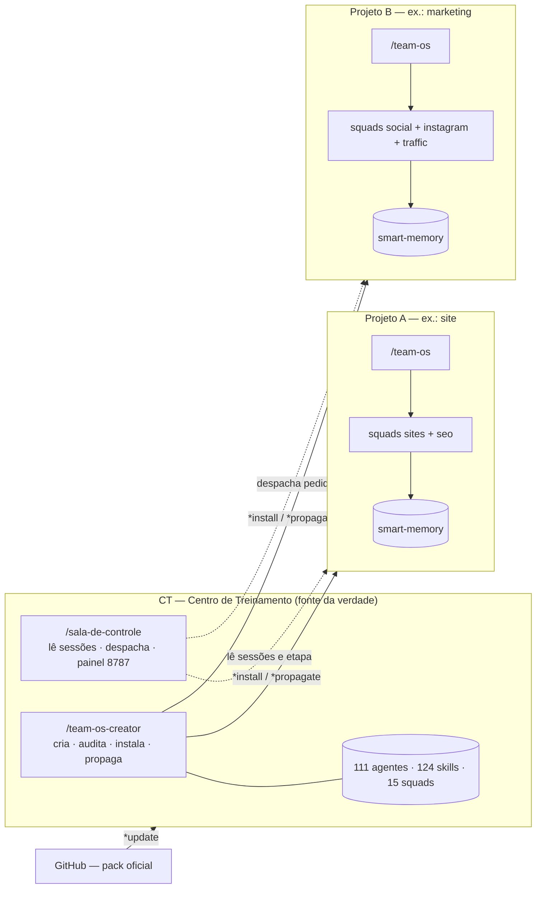

# team-os

### Pack de orquestração para Claude Code Agent Teams — *by João Guirunas*

**O team-os transforma o Claude Code num time de especialistas.** São **111 agentes e 124 skills** em **15 squads** (Dev, Sites, SEO, Security, Social — estúdio comum, Instagram, TikTok, YouTube, LinkedIn, Traffic, PM, Sales, Brand, Finance e Legal), prontos para trabalhar em paralelo com o recurso **Agent Teams** do Claude Code. Cada agente tem um papel com fronteira clara (quem planeja, quem produz, quem aprova, quem publica), uma memória compartilhada que persiste entre sessões e regras de qualidade embutidas.

**Para quem é:** quem já usa o Claude Code (no app, aba **Code**, ou no terminal) e quer tocar vários projetos com times de IA em vez de uma conversa só — produto e software, sites, conteúdo orgânico e tráfego pago, propostas comerciais, marca, financeiro e jurídico do dia a dia. Serve para quem trabalha sozinho, para agências e consultorias com vários clientes e para equipes que querem um método repetível. Você não precisa saber criar agentes: instala as squads que o projeto pede e conversa em português.

> Este repositório é o **CT — Centro de Treinamento**, a **fonte da verdade** do pack: agentes e skills são editados **aqui**, auditados com `/team-os-creator *audit` e levados aos projetos com `/team-os-creator *propagate`. Nunca edite agentes direto num projeto.

---

## Como o pack se organiza

Três skills fazem o pack funcionar. Uma vai para todo projeto; duas ficam só no CT.

| Peça | Onde mora | O que faz |
|---|---|---|
| **`/team-os`** | Em **todo projeto** (o `*install` leva) | Bootstrap e orquestração da sessão. É o 1º comando de cada sessão: liga o Agent Teams, roda o **Discovery Engine** (lê o código e monta a smart-memory na 1ª vez), pergunta o objetivo, propõe o time do tamanho do trabalho e cria as tasks. Tem `*grill` (sabatina para objetivo vago), `*compact` (enxuga a memória) e sugere automações sem aplicar nada sem OK. → [§3](#3-skill-principal-team-os) |
| **`/team-os-creator`** | **Só no CT** | A factory do pack. O **Command Center** mostra cada projeto da pasta pai (team-os instalada? agentes? desatualizado?) e oferece criar, atualizar, instalar e organizar. Comandos: `*create`/`*squad`, `*audit`, `*install`, `*propagate`, `*update`, `*painel` (mapa do pack em `127.0.0.1:8788`), `*migrate-social`, `*migrate-sala` e `*feedback`. → [§4](#4-skill-principal-team-os-creator) |
| **`/sala-de-controle`** | **Só no CT** | O lugar único de comando. Enxerga **todas as sessões do Claude Code da máquina**, sabe a etapa de cada projeto pela smart-memory dele, despacha cada pedido para a sessão certa e abre o **painel dos agentes em produção** (`127.0.0.1:8787`). Lê e roteia, **nunca executa em outro projeto**; a memória dela fica no CT, fora do git. → [§6](#sala-de-controle--sala-de-controle-mora-no-ct) |



Em volta dessas três peças, quatro mecanismos valem para todos os agentes:

- **Native Teams Protocol** — o contrato que todo agente carrega, byte a byte igual: a smart-memory é a fonte da verdade, o trabalho passa pela TaskList nativa, os agentes conversam direto entre si (peer-to-peer) e ninguém cria sub-time. → [§1](#1-conceitos-fundamentais) · [§8](#8-modelo-de-coordenação)
- **Smart-memory** — `docs/smart-memory/` em cada projeto, no formato do Obsidian (frontmatter, wikilinks, tags). Leitura em camadas: cada agente lê o índice, o `DIGEST.md` da sua área e as stories ativas, nunca pastas inteiras; o frio vai para `_archive/` com `*compact`. → [§11](#11-estrutura-do-repositório)
- **Hooks de qualidade e de economia de tokens** — 14 hooks: push só pelo devops, task vaga recusada, publicação/envio/pagamento só com PASS e confirmação do usuário, leitura de memória com orçamento, mensagem entre agentes curta e aviso de contexto grande. → [§10](#10-hooks-de-qualidade)
- **Política de modelos Híbrida** — `opus` fixo onde o raciocínio decide (28 agentes: arquitetos, planejadores, QAs e estrategistas); `inherit` no resto (83), que segue o `/model` da sua sessão. → [§9](#9-política-de-modelos-híbrido)

---

## Por que team-os?

Times de IA superam uma sessão única quando o trabalho tem partes independentes. O team-os transforma isso em algo pronto pra usar:

- **Paralelismo real** — várias sessões trabalham ao mesmo tempo, cada uma com seu próprio context window. Research, review e features divididas por módulo terminam em uma fração do tempo de uma sessão sequencial.
- **Especialização com autoridade clara** — 111 papéis prontos, com fronteiras explícitas (quem cria story, quem dá veredicto de QA, quem faz `git push`). Sem sobreposição, sem agente pisando no outro.
- **Coordenação autônoma** — comunicação peer-to-peer + TaskList compartilhada + self-claim. Os teammates se organizam sozinhos; o lead orquestra em vez de microgerenciar.
- **Memória que persiste** — smart-memory em formato Obsidian acumula arquitetura, decisões, stories e QA entre sessões. O time não recomeça do zero.
- **Qualidade embutida** — hooks (`block-git-push`, gates de task), QA com veredicto formal PASS/CONCERNS/FAIL/WAIVED e plan mode obrigatório em mudanças de risco (schema, auth, CI/CD).
- **Custo sob controle** — política de modelos **Híbrida**: `opus` só onde o raciocínio é crítico (arquitetura, veredictos), `inherit` no resto (seguem o `/model` do lead). Você baixa a frota inteira pra um modelo barato quando quiser.
- **Reuso instantâneo** — `/team-os-creator *install` leva squads + skills + smart-memory para qualquer projeto. Uma fonte da verdade, propagação controlada.
- **Menos context-rot** — cada agente é isolado: exploração e logs ficam no context dele, não no seu.

---

## Índice

- [Como o pack se organiza](#como-o-pack-se-organiza) — `/team-os`, `/team-os-creator`, `/sala-de-controle` e o diagrama
- [Por que team-os?](#por-que-team-os)
- [Squads](#squads) — as 15 squads, personas e como combinar
- ⭐ [the team-os Method](#-the-team-os-method) — a metodologia
- [Instalar e atualizar](#instalar-e-atualizar) — baixar, instalar, `*update`, onde ficam os meus agentes
1. [Conceitos fundamentais](#1-conceitos-fundamentais)
2. [Pré-requisitos e setup](#2-pré-requisitos-e-setup) — [Requisitos de máquina](#requisitos-de-máquina) · [MCPs por squad](#mcps-por-squad)
3. [Skill principal: `/team-os`](#3-skill-principal-team-os)
4. [Skill principal: `/team-os-creator`](#4-skill-principal-team-os-creator)
5. [Os 111 agentes e suas skills](#5-os-111-agentes-e-suas-skills)
6. [Catálogo completo de skills](#6-catálogo-completo-de-skills) — as 124, com para que serve e quem usa · [Sala de Controle](#sala-de-controle--sala-de-controle-mora-no-ct)
7. [Tutorial passo a passo](#7-tutorial-passo-a-passo)
8. [Modelo de coordenação](#8-modelo-de-coordenação)
9. [Política de modelos (Híbrido)](#9-política-de-modelos-híbrido)
10. [Hooks de qualidade](#10-hooks-de-qualidade)
11. [Estrutura do repositório](#11-estrutura-do-repositório)
12. [Troubleshooting](#12-troubleshooting)
13. [Manutenção do CT](#13-manutenção-do-ct)
- [Licença](#licença)

---

## Squads

Cada projeto recebe só as squads de que precisa (`/team-os-creator *install --squads sites,seo`, por exemplo). As 15 squads, com as personas dos agentes na ordem do preset — os perfis completos estão em [§5](#5-os-111-agentes-e-suas-skills) e na página [`docs/agentes.html`](./docs/agentes.html):

| Squad | Papel | Agentes (personas) | Como entra no projeto |
|---|---|---|---|
| **`dev`** (12) | Software complexo (SaaS): arquitetura, front, back, dados/BI, hardening, QA e devops | Lyra, Zael, Vela+Astra, Nova, Rex, Sera, Kron, Axis, Grav, Byte, Kairo, Sigma | Base (projeto de software); combine com `security` |
| **`sites`** (10) | Sites e landing pages em Next.js ou Astro, do UX ao deploy | Zael-S, Lyra-S, Vela-S, Nova-S, Rex-S, Sera-S, Kron-S, Axis-S, Grav-S, Byte-S | Base (site); combine com `seo` e/ou `security` |
| **`seo`** (15) | Auditoria e otimização de busca, inclusive busca por IA — audita e recomenda, não implementa | THOTH, PTAH, NEITH, KHNUM, GEB, SHU, NUT, HORUS, HEKA, BASTET, ANUBIS, HAPI, SESHAT, WADJET, MAAT | Add-on de `sites` (handoff do fix para a squad sites) |
| **`security`** (7) | Segurança de aplicação: ameaças, appsec, código gerado por IA, segredos, privacidade e incidentes | MIMIR, HEIMDALL, HUGIN, VÁR, FRIGG, VIDAR, FORSETI | Add-on de `dev` ou `sites` (dev/sites corrige) |
| **`social`** (3) | Estúdio comum de produção: arte, foto e vídeo, só sob brief — não aprova nem publica | AEON, IRIS, FLUX | Add-on de `instagram`, `tiktok`, `youtube` e/ou `linkedin` (sozinha não tem gate) |
| **`instagram`** (3) | Instagram, página do Facebook e Threads: pauta, copy, DM/ManyChat e publicação via Meta | VERA, LYRIS, PULSE | Plataforma; instale com `social` |
| **`tiktok`** (3) | TikTok orgânico: pauta, sons em alta, roteiro nativo e pacote de upload | RIFF, BEAT, LOOP | Plataforma; instale com `social` |
| **`youtube`** (3) | Canal do YouTube: pauta de 90 dias, roteiro longo e Shorts, pacote e leitura do canal | KAIROS, ECHO, ORBIT | Plataforma; instale com `social` |
| **`linkedin`** (3) | LinkedIn B2B, perfil pessoal e página: posts, PDF, artigos e pacote de publicação | STRATA, QUILL, RELAY | Plataforma; instale com `social` |
| **`traffic`** (10) | Tráfego pago em Google, Meta e TikTok: estratégia, criativo, setup, QA e atribuição | Axar, Lyrath, Bytax, Florix, Koprath, Pixrek, Gorix, Zukar, Tokris, Gathar | Base; usa o estúdio `social` para criativo quando instalado |
| **`pm`** (10) | Gestão de projetos e portfólio: demandas, sprints, operação diária, reuniões e QA de entregas | Zynath, Serak, Nexar, Draketh, Varek, Faelor, Aevon, Eshara, Lyrith, Thyron | Base (operação e portfólio) |
| **`sales`** (8) | Propostas e apresentações comerciais: intake, tese, números com fonte, copy, PDF e follow-up | ATLAS, ATHENA, DAEDALUS, LIBRA, CALLIOPE, HELIOS, ARGUS, PEITHO | Base (comercial) |
| **`brand`** (8) | Reposicionamento de marca: pesquisa, plataforma, voz, identidade visual, medição e implantação | SIRIUS, POLARIS, ORION, LYRA, AURORA, VEGA, ALTAIR, RIGEL | Base; o kit de marca alimenta sites, social, traffic e sales |
| **`finance`** (8) | Gestão financeira: conciliação, fechamento, caixa de 13 semanas, cobrança, fiscal e relatório | NILO, AMAZONAS, DANUBIO, GANGES, TEJO, RENO, SENA, TIGRE | Base (back-office) |
| **`legal`** (8) | Jurídico do dia a dia: pesquisa, postura, minutas, registro de contratos, LGPD e conflitos | VERITAS, PRUDENTIA, LEX, CONCORDIA, FIDES, CLEMENTIA, AEQUITAS, IUSTITIA | Base (back-office) |

**Regra das squads de plataforma.** Conteúdo orgânico é dividido em um **estúdio comum** e quatro squads de plataforma:

- **`social`** é o estúdio — AEON (arte e Key Visual, via Stitch), IRIS (foto com IA, via Freepik) e FLUX (vídeo com ffmpeg e avatar HeyGen). Produz só sob brief de uma plataforma com pauta aprovada (ou do `traffic-strategist`, para anúncio); nunca aprova nem publica.
- **`instagram`** (VERA · LYRIS · PULSE, inclui Facebook e Threads), **`tiktok`** (RIFF · BEAT · LOOP), **`youtube`** (KAIROS · ECHO · ORBIT) e **`linkedin`** (STRATA · QUILL · RELAY) seguem o mesmo trio: o **strategist** define a pauta e é o gate (PASS/CONCERNS/FAIL escrito), o **content** escreve, o **publisher** publica ou monta o pacote para você subir — sempre com PASS **e** a sua confirmação.
- **Aprovação não se transfere entre plataformas:** uma peça aprovada no Instagram passa de novo pelo gate do TikTok antes de ir para lá.
- **Impulsionar é sempre da squad `traffic`:** boost na Meta é do `traffic-meta`, Spark Ads do `traffic-tiktok`, anúncio no YouTube do `traffic-google`. Os publishers orgânicos nunca gastam.

Projetos de antes dessa divisão (squad `social` antiga, com strategist/content/publisher) migram com `/team-os-creator *migrate-social` — simula primeiro, aplica só com OK.

---

## ⭐ the team-os Method

A metodologia que torna o pack repetível para a sua equipe e seus mentorados. São **duas camadas** e **7 fases**.

### Duas camadas

```
CAMADA 1 — CT (configuração e manutenção, no command center)
  abre `claude` (puro) na pasta do CT
   └─ /team-os-creator  →  escaneia os projetos irmãos e mostra status (team-os? agentes? drift?)
        ├─ [1] Criar equipe       → novos agentes/squad (Native Teams Protocol + smart-memory + skills + modelo híbrido)
        ├─ [2] Atualizar equipes  → propaga o drift para os projetos
        ├─ [3] Instalar equipe    → instala squad + skills + team-os num projeto
        └─ [4] Organizar pastas   → árvore negócio → projeto → squads, o que está fora do padrão e a proposta
   → cada projeto passa a ter: agentes + skills + /team-os  (NUNCA team-os-creator)

CAMADA 2 — Projeto (execução, toda sessão de trabalho)
  abre `claude agents` (agent view)
   └─ /team-os  (SEMPRE o 1º comando da sessão)
        ├─ valida Agent Teams nativo
        ├─ sem smart-memory? → Discovery: lê o codebase e a constrói ANTES de começar
        └─ organiza o time com paralelismo máximo e dispara a execução
```

### As 7 fases

| # | Fase | O que acontece | Onde |
|---|---|---|---|
| 1 | **Setup** | Instalar a squad no projeto via `/team-os-creator *install` (uma vez por projeto). | CT |
| 2 | **Bootstrap** | `/team-os` no início de **toda** sessão — valida o ambiente de Agent Teams nativo. | Projeto |
| 3 | **Discovery** | Sem smart-memory? O team-os lê o codebase real e **constrói a smart-memory populada** antes de qualquer trabalho. | Projeto |
| 4 | **Team Design** | Objetivo → mapeia **workstreams independentes** → spawna o time certo (**comece com 3-5**, 1 por workstream independente, sem teto fixo), com ownership exclusivo de arquivos — onde o ownership não é disjunto, serializa com task dependencies. | Projeto |
| 5 | **Parallel Execution** | TaskList compartilhada + self-claim + comunicação **peer-to-peer** entre teammates. | Projeto |
| 6 | **Sync & QA** | Veredictos formais (PASS/CONCERNS/FAIL/WAIVED), gates por hook, hardening. | Projeto |
| 7 | **Memory & Ship** | Cada agente grava findings na smart-memory; DevOps faz push/PR/release. | Projeto |

### Princípios

- **Paralelismo é o default, sem teto fixo.** O limite não é um número mágico — é **independência real** (ownership de arquivos disjunto) + budget de tokens. N módulos independentes → N agentes, seja 5 ou 15.
- **Smart-memory é o cérebro compartilhado.** Todo agente lê ao iniciar e grava ao concluir. O time nunca recomeça do zero.
- **Autoridade clara, sem sobreposição.** Quem cria story, quem dá veredicto, quem faz push — cada papel tem fronteira explícita.
- **Uma fonte da verdade.** Tudo nasce no CT e é propagado; nunca se edita agente direto no projeto.

---

## Instalar e atualizar

Esta seção é para quem **usa** o pack. (Quem mantém o pack oficial tem outro ciclo: [MAINTAINERS.md](./MAINTAINERS.md).)

### Do zero ao time rodando

**Pré-requisitos:** o app do Claude com a aba **Code** (ou o Claude Code no terminal), um plano com Agent Teams, e `git`, `bash` e `python3` na máquina. Você **não** precisa configurar o Agent Teams: o `*install` e a `/team-os` fazem isso.

A ideia em uma linha: o **CT** (o clone deste repositório) é onde você monta e mantém as equipes; os **projetos** são onde elas trabalham.

#### 1. Crie a pasta pai e as pastas dos projetos

Uma pasta pai (o nome é livre, por exemplo `Projetos`) guarda o CT e todos os seus projetos, lado a lado. Projetos podem ficar soltos ou agrupados por negócio.

```
Projetos/
├── 0 | Centro de Treinamento/   ← o clone do team-os (passo 2) — também é a Sala de Controle
├── projeto-a/
└── Minha Empresa/
    ├── Minha Empresa | Site/
    └── Minha Empresa | Comercial/
```

**Por quê:** o CT enxerga os projetos olhando a pasta onde ele mesmo está. **Você deve ver:** a pasta pai com as pastas dos projetos dentro.

#### 2. Clone o team-os dentro da pasta pai

Num terminal aberto na pasta pai (ou pedindo ao Claude, na aba Code, com a pasta pai aberta):

```bash
git clone https://github.com/joaoguirunas/team-os.git "0 | Centro de Treinamento"
```

O nome da pasta é livre; o `0 |` só faz o CT aparecer primeiro na lista. Sem git, baixe o `.zip` do GitHub e descompacte no mesmo lugar.

**Por quê:** o clone é o CT, a fonte da verdade dos agentes e das skills. **Você deve ver:** a pasta do CT ao lado das pastas dos projetos.

> Seus projetos estão em outro lugar? Crie, na raiz do CT, um arquivo `.team-os-root` com o caminho da pasta pai (uma linha). Ele fica fora do git.

#### 3. Abra o CT e rode o Command Center

No app do Claude, abra a pasta do CT na aba Code e rode:

```
/team-os-creator
```

**Por quê:** o CT é a camada de configuração. Aqui você cria, instala e atualiza equipes; não trabalha nos projetos. **Você deve ver:** uma tabela com cada projeto (team-os instalada, nº de agentes, smart-memory, desatualizado ou em dia) e quatro ações: Criar, Atualizar, Instalar, Organizar.

#### 4. Instale a equipe de cada projeto

Ainda no CT:

```
/team-os-creator *install
```

Ou em linguagem natural: *"instale a squad sites no projeto-a"*. Ele pergunta o projeto e as squads, mostra exatamente o que vai copiar e só age depois do seu OK.

Cada projeto recebe **só as squads de que precisa**, uma ou mais: `dev`, `sites`, `social`, `instagram`, `tiktok`, `youtube`, `linkedin`, `traffic`, `pm`, `sales`, `brand`, `finance`, `legal`, `seo` e `security`. As de auditoria entram como complemento: um site com SEO é `sites,seo`; um app com banco e login é `dev,security`. A `social` é o **estúdio comum** (design, foto, vídeo) e não tem gate próprio: instale-a junto de ao menos uma squad de plataforma — ex.: `social,instagram` ou `social,youtube,linkedin`. O `*install` sugere a combinação pelos sinais do projeto.

**Por quê:** cada projeto só carrega o time que vai usar. **Você deve ver:** o preview (agentes, skills, hooks) antes de confirmar. Depois, o projeto tem `.claude/agents/`, `.claude/skills/` (com a `team-os`), os hooks e o Agent Teams já ativado.

#### 5. Ligue o time no projeto

Abra a pasta do **projeto** no app (aba Code) e rode:

```
/team-os
```

Na primeira vez:

- se o Agent Teams ainda não estiver ativo nesta sessão, a `/team-os` avisa: feche e abra uma sessão nova (só acontece uma vez);
- ela lê o código do projeto e monta a **smart-memory** (`docs/smart-memory/`), a memória compartilhada da equipe.

Depois ela pergunta o objetivo da sessão e propõe um time do tamanho do trabalho (começa com 3 a 5 agentes e cresce se houver trabalho paralelo de verdade). **Nada é criado sem o seu OK.**

Com o time rodando, o **agent panel** aparece abaixo do prompt: ↑↓ navegam, Enter abre, Esc interrompe, `x` para, Ctrl+T mostra as tasks. Sessões em segundo plano ficam no **Agent view** (`claude agents`). A diferença: o agent panel mostra os teammates desta sessão; o Agent view lista sessões independentes.

**Você deve ver:** a proposta de time e, depois do OK, os agentes trabalhando no agent panel.

#### 6. (Opcional) Abra a Sala de Controle

Um lugar único para mandar pedidos para todos os projetos e ver o que cada sessão está fazendo. A Sala **mora no próprio CT**: não há pasta separada nem instalação.

Abra uma sessão nova **no CT** (deixe-a dedicada à Sala; outras sessões no CT seguem cuidando do pack) e rode:

```
/sala-de-controle
/sala-de-controle *organizar
```

**Você deve ver:** no `/sala-de-controle`, o panorama curto de todas as sessões e projetos e o painel ao vivo aberto no navegador do Claude (`127.0.0.1:8787`), com cada sessão, seus agentes por estado (ativo, aguardando, parado, precisa de você) e o consumo de tokens; no `*organizar`, a árvore negócio → projeto → squads com o que está fora do padrão.

> Já tinha uma pasta `1 | Sala de Controle` de versões antigas? O `/team-os-creator` avisa e sugere `migrate-sala-to-ct.sh` (simulação primeiro; com `--apply` a memória vai para o CT e a pasta antiga para a Lixeira). Detalhes em [§6 — Sala de Controle](#sala-de-controle--sala-de-controle-mora-no-ct).

#### 7. Mantenha tudo atualizado

| Comando (no CT) | O que faz |
|---|---|
| `/team-os-creator` | Mostra quais projetos estão desatualizados em relação ao CT |
| `/team-os-creator *update` | Traz a versão nova do pack para o seu CT, sem perder agentes, skills ou edições suas (detalhes abaixo) |
| `/team-os-creator *propagate` | Leva as mudanças do CT para os projetos, só nas squads que cada um já tem; se você editou um arquivo no projeto, ele pergunta antes de trocar |
| `/team-os-creator *audit` | Confere se os agentes e as skills do CT seguem o padrão (rode depois de criar ou editar) |

O `*propagate` não faz commit nos projetos: as mudanças ficam esperando o commit na sessão de cada projeto.

### Como atualizar o pack (`*update`)

A cada versão nova, o pack ganha agentes, skills e correções. Para trazer isso para a sua pasta **sem perder nada que é seu**, abra o Claude Code na pasta do CT e rode:

```
/team-os-creator *update
```

Passo a passo:

1. **Ele só olha primeiro.** Compara a sua versão com a mais nova publicada e mostra, em poucas linhas, o que mudou e quantos arquivos serão atualizados. Nada é alterado nessa etapa.
2. **Você confirma uma vez.** Sem o seu "pode atualizar", nada acontece.
3. **Ele baixa a versão nova, confere cada arquivo** (se algum não bater com o que foi publicado, ele para e não altera nada) e só então troca os arquivos, um a um.
4. **Guarda uma cópia de segurança** só dos arquivos que trocou, em `.team-os/backups/` (as 3 últimas ficam; as mais antigas vão para a Lixeira).
5. **Se você tiver editado algum arquivo do pack**, veja abaixo.
6. **Confere tudo no final** (o mesmo `*audit`) e escreve um relatório em `.team-os/update-report.md`.
7. **Oferece levar a versão nova para os seus projetos** (`*propagate`), mostrando antes o que mudaria em cada um.

**O que o `*update` nunca toca:**

- os agentes que **você** criou (`origin: custom`) e as skills que você criou;
- seus presets em `.claude/skills/team-os-creator/presets/custom/`;
- a smart-memory dos projetos (`docs/smart-memory/`), seus arquivos de configuração local (`.claude/settings.local.json`) e o arquivo `.team-os-root`;
- qualquer arquivo seu que não faça parte do pack.

O `*update` também **não mexe no seu git**: não roda `git pull`, não faz commit e não envia nada. O que fazer com o git da sua pasta é decisão sua (se quiser guardar o resultado num repositório seu, você mesmo faz o commit).

**E se eu editei um arquivo do pack?** Ele nunca sobrescreve o seu. Se a versão nova mexeu no mesmo arquivo, o seu continua como está e a versão nova é gravada ao lado, com o nome `<arquivo>.new`. Aí o Claude pergunta, um arquivo por vez, o que você prefere: **manter o meu** (a versão nova é descartada), **usar o novo** (o seu fica guardado em `.team-os/backups/`) ou **ver a diferença** antes de decidir. Se você quiser decidir depois, tudo bem: as pendências continuam anotadas.

**Como desfazer:** peça ao Claude, na pasta do CT, para desfazer a última atualização do pack (por baixo, é `bash .claude/skills/team-os-creator/scripts/update-pack.sh --undo`). Os arquivos trocados voltam ao que eram e os que a atualização tinha acrescentado vão para a Lixeira.

> ⚠️ **Versões anteriores à 2.4.0 não têm `*update`.** Se a sua pasta está numa delas (confira o arquivo `VERSION`; se ele não existir, é uma versão anterior), atualize **uma única vez** com `git pull` dentro da pasta do CT (ou baixando o pack de novo). Dali em diante, use sempre `*update`. Cuidado: o `git pull` pode reclamar se você editou arquivos do pack — nesse caso, guarde uma cópia do que você mudou antes de puxar.

### Onde ficam os meus agentes

Os agentes que você cria com `/team-os-creator *create` (ou `*squad`) nascem como **agentes próprios**: o arquivo em `.claude/agents/` leva `origin: custom` no cabeçalho e o registro fica em `.claude/skills/team-os-creator/presets/custom/custom.yaml`. Você escolhe o nome livremente. Essa pasta e esses agentes são seus: o `*update` nunca os apaga nem os sobrescreve (ele só renova neles o bloco do Native Teams Protocol, que precisa ser igual ao da versão nova). O `*audit` confere os seus agentes com as mesmas regras dos do pack e os conta à parte ("111 do pack + N próprios"). Para levá-los a um projeto, use o `*install`/`*propagate` com a opção `--custom <nomes|all>`.

---

## 1. Conceitos fundamentais

| Conceito | O que é |
|---|---|
| **Agent Teams** | Recurso (experimental) do Claude Code onde várias sessões trabalham em paralelo como um time. Uma sessão é o **lead**; as demais são **teammates**, cada uma com seu próprio context window. |
| **Lead nativo** | A **main session** do Claude Code é o lead — não existe agente "orquestrador". O lead spawna teammates, distribui tasks e sintetiza resultados. |
| **Teammate** | Sessão independente spawnada pelo lead a partir de uma definição em `.claude/agents/`. Comunica-se **peer-to-peer** com outros teammates via `SendMessage`. |
| **Subagent** | Mesma definição rodando como helper dentro de uma sessão (reporta só ao chamador). Os arquivos em `.claude/agents/` servem aos dois modos. |
| **TaskList nativo** | Lista de tasks compartilhada pelo time. Estados `pending → in_progress → completed`, com dependências e **self-claim**. |
| **Smart-memory** | Base de conhecimento persistente em `docs/smart-memory/` (formato Obsidian: frontmatter YAML + wikilinks `[[...]]` + tags). *Source of truth* que todo agente lê ao iniciar e atualiza ao concluir. |
| **Native Teams Protocol** | Contrato que todo agente do CT carrega: smart-memory como fonte da verdade, TaskList nativo, comunicação peer-to-peer, sem nested teams. |
| **Skill** | Conhecimento carregável (`/nome-skill`). Em Agent Teams, skills são carregadas do projeto/usuário (o campo `skills:` do frontmatter é ignorado). |

**Agent Teams vs Subagents:** use **Agent Teams** quando os trabalhadores precisam conversar entre si, dividir um trabalho complexo e se coordenar. Use **subagents** quando você só quer um worker focado que reporta um resultado de volta.

---

## 2. Pré-requisitos e setup

1. **Agent Teams: você não precisa configurar nada.** A ativação já vem no pack:
   - o `*install` grava `CLAUDE_CODE_EXPERIMENTAL_AGENT_TEAMS=1` no `.claude/settings.json` do projeto (via `ensure-settings.sh`, sem sobrescrever nada que já exista);
   - a `/team-os` confere, no início de cada sessão, se o recurso está ativo de verdade e, se faltar, acrescenta a flag também no `~/.claude/settings.json`.

   **Único cuidado:** a flag só vale para sessões abertas **depois** de ela existir. Se a `/team-os` avisar que o Agent Teams não está ativo, feche a sessão e abra uma nova (só acontece na primeira vez).

2. **`teammateMode`** (opcional): default `"in-process"` (todos no terminal principal, agent panel ativo). Use `"auto"` para split panes em tmux/iTerm2. A `/team-os` sugere o ajuste.

3. Agent Teams é experimental e exige plano com suporte ao recurso — ver [limitações oficiais](https://code.claude.com/docs/en/agent-teams#limitations).

### Requisitos de máquina

Os scripts do pack são **bash 3.2-safe** (rodam no bash padrão do macOS e no ubuntu do CI) e não dependem de `jq`.

| Ferramenta | Obrigatória? | Quem usa |
|---|---|---|
| `bash` 3.2+ | Sim | todos os hooks e scripts (`.claude/hooks/`, `team-os/scripts/`, `team-os-creator/scripts/`) |
| `git` | Sim | hooks de push, `scan-ct-projects.sh`, `test-hooks.sh` |
| `python3` | Sim (≥ 3.10 para a skill `seo`) | hooks (tokenização via `shlex`, com fallback em grep), `team-os-creator` (`generate-agents-page.py`), `deep-research`, `ui-ux-pro-max`, `seo` |
| `node` | Opcional | `seo/hooks/run-python-hook.js` (hooks internos da skill `seo`) |
| `gh` (GitHub CLI) | Opcional | agentes `*-devops` (PRs, releases) e a skill `seo-flow` |
| Chromium via Playwright | Opcional | skill `seo` (renderização headless) — baixado pelo `setup` dela |
| `jq` | **Não** | nenhum script exige (`discovery.sh` e `team-os-session-title.sh` fazem o parse sem ele) |

**Setup da skill `seo`** (uma vez por máquina, por projeto — ver a seção "Instalação" em `.claude/skills/seo/SKILL.md`): `"${CLAUDE_PROJECT_DIR}/.claude/skills/seo/scripts/claude-seo" setup` (ou `/seo setup`) cria um venv isolado em `.claude/skills/seo/.venv/`, instala o `requirements.txt` e baixa o Chromium; `/seo doctor` diagnostica. Se o `python3` da máquina for < 3.10, aponte outro com a variável `CLAUDE_SEO_PYTHON` — em `.claude/settings.local.json` (gitignored) ou no `~/.claude/settings.json`, **nunca** no `settings.json` versionado do projeto. `.venv/` e `ms-playwright/` são runtime local: ignorados pelo git e nunca copiados pelo `*install`.

### MCPs por squad

Alguns agentes declaram servidores MCP em `tools:` (fonte da verdade e check do `*audit`: `.claude/skills/team-os-creator/reference/mcp-servers.md`). Servidor ausente na máquina **não quebra o agente** — o Claude Code ignora tools `mcp__*` não conectadas. YouTube, TikTok e LinkedIn não têm servidor de publicação na v1: o `*-publisher` monta o pacote e quem sobe é o usuário.

| Squad | Agente | Servidor (forma curta em `tools:`) |
|---|---|---|
| Instagram / TikTok | `instagram-content`, `tiktok-content` | `mcp__apify` (scraping/research) |
| Instagram | `instagram-publisher` | `mcp__meta` (publicação Instagram/Facebook/Threads + insights — só orgânico; boost é do `traffic-meta`) |
| Social (estúdio) | `social-design` | `mcp__stitch` (Google Stitch, design generativo) |
| Social (estúdio) | `social-photo` | `mcp__freepik` (imagens AI) |
| Social (estúdio) | `social-video` | `mcp__heygen` (avatar/vídeo AI) |
| Dev / Sites / PM | `dev-data-engineer`, `dev-bi`, `sites-data`, `pm-data` | `mcp__supabase` (via skill `data-supabase-patterns`) |
| Traffic | `traffic-google`, `traffic-automation`, `traffic-bi`, `traffic-analyst`, `traffic-qa` | `mcp__google-ads`, `mcp__ga4` / `mcp__analytics-mcp` (via skills `traffic-google-ads-mcp`, `traffic-ga4-mcp`) |

Os agentes citam o **nível do servidor** (`mcp__<server>`, sem `__<tool>`), o que libera todas as ferramentas daquele servidor — nomes de tool mudam entre versões, o nome do servidor não. O prefixo depende de **como** o servidor foi instalado; são três formas:

| Origem | Prefixo da tool | Exemplo |
|---|---|---|
| `claude mcp add <nome>` / `.mcp.json` | `mcp__<nome>__<tool>` | `mcp__stitch__generate_screen_from_text` |
| Plugin (`/plugin install`) | `mcp__plugin_<plugin>_<server>__<tool>` | `mcp__plugin_heygen_heygen__create_video` |
| Conector claude.ai | `mcp__claude_ai_<server>__<tool>` | `mcp__claude_ai_Hey_Gen__create_video_from_avatar` |

Credenciais (token, key, project-ref) nunca vão no agente nem na smart-memory — ficam no `.mcp.json`/env da máquina.

---

## 3. Skill principal: `/team-os`

**Bootstrap e orquestração de sessão.** É **distribuída para todos os projetos** (instalada junto com a squad) — você a carrega no **início de cada sessão** do projeto para coordenar múltiplos agentes em paralelo. No CT ela também existe. (A única skill que NÃO vai para os projetos é a `/team-os-creator`.)

> **Lead Discipline (regra dura):** com `/team-os` ativo, a sessão principal é **orquestrador puro** — nunca escreve código, pesquisa ou redige entregável sozinha. Para qualquer ação de trabalho ela **spawna um agente e fica livre** (monitorando, roteando, sintetizando). 1 tarefa = 1 agente, até as pequenas.

> **Team Persistence (regra dura):** o lead **nunca encerra o time sozinho**. Terminou uma rodada? Sintetiza, mantém os teammates vivos e **pergunta se há mais tasks** — só encerra quando você pede. E lembre: linha some do painel após ~30s = idle (agente **vivo**, não encerrado); reative com `SendMessage` pelo nome.

### O que ela faz, em fases
1. **Scan silencioso** — lê `settings.json` (env + teammateMode), mapeia `.claude/agents/`, lê `docs/smart-memory/INDEX.md`, **pesa a smart-memory** (`weigh-memory.sh`) e roda `TaskList`.
2. **Dashboard de abertura** — mostra status do ambiente e pergunta o **objetivo da sessão**.
3. **Correções automáticas** — injeta `CLAUDE_CODE_EXPERIMENTAL_AGENT_TEAMS` se faltar, sugere `teammateMode`, oferece bootstrap da smart-memory.
4. **Análise do objetivo** — classifica o trabalho (research / implementação / review / mixed) e mapeia o paralelismo real.
5. **Dimensionamento** — **1 workstream independente = 1 agente**, sem teto fixo: comece com 3-5 e escale conforme a independência real do trabalho (ownership de arquivos disjunto); research adversarial = 3-5 pesquisadores.
6. **Proposta de time** — agentes, ownership exclusivo de paths, plan mode onde há risco, skills por agente, modelo sugerido.
7. **Orquestração** — cria as tasks no TaskList com dependências e orienta o spawn.

### Comandos
```
/team-os                → bootstrap completo da sessão
/team-os *env           → só verificar/corrigir settings.json
/team-os *memory        → status/bootstrap da smart-memory
/team-os *compact       → compactação integral (mecânica + archivist), 1 confirmação; --auto sem confirmação
/team-os *tasks         → mostrar a task list atual
/team-os *spawn {desc}  → proposta de time para {desc} (pula o scan)
/team-os *grill {obj}   → modo sabatina: perguntas em rodadas, cada uma com resposta recomendada (objetivo vago ou grande)
/team-os *status        → dashboard do time atual
```

### Boas práticas que ela aplica
- **Spawn prompts cirúrgicos** (papel + paths de ownership + contexto + entregável + como reportar).
- **Ownership exclusivo de arquivos** — dois agentes nunca no mesmo arquivo.
- **Plan mode** obrigatório em alto risco (schema, auth, CI/CD, refactors grandes, breaking changes).
- **Não encerrar o time cedo** — se o lead "concluir" com tasks abertas, ela orienta a continuar.
- **Correção vira `[skill-feedback]`** — quando você corrige o trabalho de um agente ou o método de uma skill, o lead grava uma linha `[skill-feedback] <skill|agente>: <correção> (AAAA-MM-DD)` no `_inbox/` (sem dado de cliente nem segredo). O `*compact` copia essas linhas sem alteração para o `DIGEST.md` da área; no CT, `/team-os-creator *feedback` as junta e propõe a melhoria na skill ou no agente.
- **Automações sugeridas** — o Discovery registra em `project/tech-stack.md` um bloco `## Automações sugeridas (não aplicadas)` (formatar/lintar ao editar, bloquear `.env`, não editar lockfile, MCP de documentação); nada é aplicado sem o seu OK — o bloqueio de `.env` vira o hook opcional `guard-env-files.sh` (§10).

---

## 4. Skill principal: `/team-os-creator`

**Factory de agentes.** Existe **somente no CT**. Gera arquivos `.claude/agents/*.md` completos (Native Teams Protocol + smart-memory) a partir de **9 archetypes** e 15 presets de squad, e mantém os agentes alinhados.

### Comandos
```
/team-os-creator                       → Command Center: escaneia as pastas irmãs, status por projeto, ações Criar / Atualizar / Instalar (avisa pasta de Sala antiga e sugere migrate-sala-to-ct.sh)
/team-os-creator *analyze              → detecta archetype/stack, sem criar
/team-os-creator *squad <preset>       → cria uma squad inteira (dev/sites/social/instagram/tiktok/youtube/linkedin/traffic/pm/sales/brand/finance/legal/seo/security/custom)
/team-os-creator *create <role>        → cria UM agente interativamente
/team-os-creator *migrate              → reinjeta o bloco NTP canônico em todos os agentes (scripts/migrate-ntp.sh; --dry-run mostra o diff)
/team-os-creator *bootstrap            → cria docs/smart-memory/ + injeta protocolo no CLAUDE.md do projeto atual
/team-os-creator *skills <ag>          → enriquece um agente com skills relevantes
/team-os-creator *pressure-test <ag>   → testa o agente contra cenários adversariais (obrigatório para agente novo antes do *propagate)
/team-os-creator *audit                → valida compliance dos agentes (validate-agent.sh) E das skills (validate-agent.sh --skills)
/team-os-creator *update               → atualiza o pack para a versão mais nova sem perder o que você criou ou editou (ver [Instalar e atualizar](#instalar-e-atualizar))
/team-os-creator *propagate            → propaga agentes/skills atualizados para os destinos (sempre --match-target-squads)
/team-os-creator *feedback             → junta as linhas [skill-feedback] dos projetos (scripts/feedback-scan.sh, só leitura), agrupa por skill/agente e propõe a melhoria no CT — aplica só com OK
/team-os-creator *migrate-social <pasta> → leva um projeto da squad social antiga para o estúdio social + squad(s) de plataforma (migrate-social-split.sh; simula primeiro, --apply --platforms só com OK)
/team-os-creator *migrate-sala <pasta>  → leva uma pasta de Sala de Controle antiga (fora do CT) para o CT (migrate-sala-to-ct.sh; simula primeiro, --apply só com OK)
/team-os-creator *install              → instala squads + skills (incl. team-os) + settings.json + hooks num projeto destino
/team-os-creator *organize             → árvore negócio → projeto → squads + proposta de organização (só propõe)
/team-os-creator *painel               → mapa do pack no navegador do Claude: squads, agentes (persona + cargo), skills; clique abre perfil e arquivo (127.0.0.1:8788)
```

No CT também roda a **Sala de Controle** (ver [§6](#sala-de-controle--sala-de-controle-mora-no-ct)):

```
/sala-de-controle                      → lê todas as sessões/projetos, panorama curto e abre o painel ao vivo dos agentes em produção (127.0.0.1:8787)
/sala-de-controle *painel              → reabre o painel ao vivo (*painel stop derruba)
/sala-de-controle *organizar           → árvore negócio → projeto → squads + proposta (só propõe)
```

**Como o `*install` funciona** (`scripts/install-to-project.sh`):
- **Squads por categoria** — `--squads <lista>` explícito para projeto novo (`--squads all` é abortado); `--match-target-squads` (modo `*propagate`) deriva as squads do que **já existe** no destino e nunca re-adiciona squad podada.
- **Skills derivadas dos agentes** — a lista instalada é a união de: skills citadas no body dos agentes instalados, `team-os` (sempre), `--extra-skills`, skills com prefixo da squad e as já presentes no destino. `--dry-run` imprime a origem de cada uma (`SKILL_ORIGIN=…`). Lixo (`.venv`, `ms-playwright`, `__pycache__`, `.DS_Store`…) nunca é copiado.
- **Backup + settings** — no `*install`, se o destino já tinha `.claude/`, tudo é copiado antes para `.claude.bak-<timestamp>/` (guarda só as 3 mais recentes; as antigas vão para a Lixeira) — o `*propagate` não faz backup; o `settings.json` é garantido pelo `team-os/scripts/ensure-settings.sh` (merge idempotente, nunca sobrescreve valores existentes).
- **Hooks** — o pacote padrão (`block-worktree`, `block-git-push`, `guard-push-branch`, `task-quality` e os 5 `check-*-progress`) é **sempre** instalado; `--include-hooks` é praticamente no-op.
- **Sala de Controle não se instala** — ela mora no CT; `--extra-skills sala-de-controle` é recusado (`ERROR=sala_mora_no_ct`). Num destino que ainda é uma pasta de Sala antiga, o `*propagate` não atualiza: avisa `LEGACY_CONTROL_ROOM` e mostra o comando de migração (`migrate-sala-to-ct.sh`).
- **Raiz dos projetos destino** (`scripts/scan-ct-projects.sh`): argumento, env `CT_ROOT`, arquivo `.team-os-root` na raiz do CT (gitignored) ou o diretório pai do git root.

### Os 9 archetypes
| Archetype | Quando usar | Model | Effort |
|---|---|---|---|
| `architect` | Design arquitetural, ADRs, stories | `opus` | `high` |
| `strategist` | Tese/postura/política e gate de aprovação — decide, nunca produz a peça | `opus` | `high` |
| `reviewer` | QA com veredicto formal, read-only em código | `opus` | `high` |
| `implementer` | Escreve código (front/back/fullstack) | `inherit` | omitido |
| `hardening` | Resiliência, retry, edge cases (após features) | `inherit` | `high` |
| `researcher` | Pesquisa técnica, libs, CVEs | `inherit` | `medium` |
| `data` | Schema, migrations, queries, RLS | `inherit` | `high` |
| `devops` | Git, push, PRs, CI/CD, releases | `inherit` | omitido |
| `ux` | UX research, component specs, a11y | `inherit` | `medium` |

> Não existe archetype de lead/orquestrador — a main session já é o lead nativo (regra absoluta da skill). Nenhum archetype usa `isolation` (worktrees são bloqueados pelo `block-worktree.sh`). Defaults completos em `.claude/skills/team-os-creator/reference/archetypes.md`; templates em `templates/`.

### Regras absolutas da factory
- Nunca cria agente sem `memory: project`.
- Sempre injeta o bloco **Native Teams Protocol** (nunca o antigo "Contrato com team-os").
- Sempre valida com `validate-agent.sh` após criar.
- Idempotente — se o agente existe, oferece atualizar / pular / renomear / cancelar.
- `*install` entrega a **infra, não a smart-memory**: copia agentes + skills (incluindo `team-os`) + `settings.json` + hooks. A smart-memory é construída no destino pelo próprio `/team-os` na 1ª sessão (Discovery Engine); `*bootstrap` continua disponível para criação manual.
- `team-os` **é distribuída** a todos os projetos (obrigatória no destino); `team-os-creator` e `sala-de-controle` ficam só no CT — nunca vão para projeto.

---

## 5. Os 111 agentes e suas skills

Spawne pelo nome do arquivo, ex.:
`"Spawn um teammate usando o agente dev-architect para mapear a arquitetura de auth"`.

A coluna **Skills relacionadas** é um mapa de skills **recomendadas/disponíveis por papel** — as skills de apoio que fazem sentido para cada agente acionar via `/nome-skill` conforme a necessidade. Ela **não** reflete linha a linha o que o body de cada agente lista (vários agentes citam só um subconjunto, ou nenhuma, no próprio arquivo); serve como guia de qual skill ativar para qual tipo de trabalho. O `/team-os` pode incluí-las no spawn prompt.

> **Nota sobre veredictos QA:** todas as squads com QA dedicado (`dev`, `sites`, `traffic`, `sales`, `brand`, `finance`, `legal`, `seo`, `security`) usam PASS/CONCERNS/FAIL/WAIVED. As squads de plataforma (`instagram`, `tiktok`, `youtube`, `linkedin`) não têm QA dedicado: o `<plataforma>-strategist` acumula estratégia + gate editorial e emite PASS/CONCERNS/FAIL escrito, com timestamp. Exceção deliberada em contexto PT-BR — `pm-qa`: APROVADO/PENDÊNCIAS/REPROVADO.

### Dev — Fullstack SaaS (12)

> Sem teto de tamanho por squad — a dev inclui a camada completa de dados/BI (`dev-bi`, `dev-data-engineer`, `dev-data-performance`), chegando a 12.
| Agente | Papel | Skills relacionadas |
|---|---|---|
| `dev-analyst` | Pesquisa técnica, libs, CVEs, feasibility | `/deep-research`, `/data-analytics-engineering` |
| `dev-architect` | Arquitetura, ADRs, **criação/validação de stories** (exclusivo) | `/dev-api-design`, `/dev-technical-writing`, `/dev-database-patterns` |
| `dev-bi` | Data architect & dashboards (SELECT-only) | `/data-analytics-engineering`, `/data-sql-optimization`, `/data-lake-platform` |
| `dev-data-engineer` | Schema, migrations, RLS, otimização | `/dev-database-patterns`, `/data-sql-optimization`, `/dev-security-patterns` |
| `dev-data-performance` | Insights, anomalias, forecasts | `/data-analytics-engineering`, `/ai-ml-data-science`, `/ai-ml-timeseries` |
| `dev-ux` | UX research + design visual + a11y | `/ui-ux-pro-max`, `/accessibility`, `/web-design-guidelines`, `/ui-craft` |
| `dev-dev-alpha` | Frontend (React, Next.js, Tailwind) | `/dev-typescript-patterns`, `/dev-testing-strategy`, `/dev-error-handling`, `/ui-craft` |
| `dev-dev-beta` | Backend (APIs, serviços, lógica) | `/dev-api-design`, `/dev-error-handling`, `/dev-database-patterns`, `/dev-debugging` |
| `dev-dev-gamma` | Fullstack / cross-layer | `/dev-typescript-patterns`, `/dev-database-patterns`, `/dev-error-handling` |
| `dev-dev-delta` | Hardening e resiliência | `/dev-security-patterns`, `/dev-testing-strategy`, `/dev-error-handling`, `/dev-debugging`, `/core-web-vitals` |
| `dev-qa` | Veredictos PASS/CONCERNS/FAIL/WAIVED (exclusivo) | `/dev-testing-strategy`, `/dev-security-patterns`, `/ui-craft`, `/dev-debugging` |
| `dev-devops` | `git push`, PRs, CI/CD, releases (exclusivo) | `/dev-git-workflow` |

### Sites — Sites e landing pages (10)

> **Duas stacks, uma squad:** Next.js (App Router) ou Astro (Content Collections, Islands Architecture) — o `sites-architect` decide qual usar por projeto (ou um híbrido das duas), registrado como ADR. `/sites-frontend-stack` e `/sites-seo-technical` cobrem as duas stacks lado a lado, com a mesma profundidade. Astro é a recomendação padrão quando SEO/Core Web Vitals são a prioridade — HTML puro por padrão, JS só onde uma ilha pede explicitamente.

| Agente | Papel | Skills relacionadas |
|---|---|---|
| `sites-analyst` | Keyword/competitor research, feasibility | `/deep-research`, `/sites-seo-keywords` |
| `sites-architect` | Arquitetura de páginas, stories (exclusivo) | `/dev-api-design`, `/dev-technical-writing`, `/sites-seo-technical` |
| `sites-data` | Schema, migrations, RLS (sites) | `/dev-database-patterns`, `/data-sql-optimization`, `/dev-security-patterns` |
| `sites-ux` | UX research + design visual + a11y | `/sites-ux-interaction`, `/ui-ux-pro-max`, `/accessibility`, `/sites-frontend-stack`, `/ui-craft` |
| `sites-dev-alpha` | Frontend / landing pages (shadcn) | `/sites-frontend-stack`, `/sites-scroll-motion`, `/ui-ux-pro-max`, `/nextjs-react-best-practices`, `/verify-before-done`, `/ui-craft` |
| `sites-dev-beta` | Backend / CMS / integrações | `/dev-api-design`, `/dev-error-handling`, `/dev-database-patterns` |
| `sites-dev-gamma` | CRO, SEO, analytics, fullstack | `/sites-page-cro`, `/sites-seo-technical`, `/dev-typescript-patterns` |
| `sites-dev-delta` | Hardening, Core Web Vitals | `/dev-security-patterns`, `/dev-error-handling`, `/accessibility`, `/verify-before-done`, `/dev-debugging`, `/core-web-vitals` |
| `sites-qa` | QA: a11y, SEO, copy, performance, segurança | `/dev-security-patterns`, `/dev-testing-strategy`, `/testing-playwright-e2e`, `/web-design-guidelines`, `/sites-seo-technical`, `/accessibility`, `/sites-copy`, `/verify-before-done`, `/ui-craft` |
| `sites-devops` | Deploy Vercel/Netlify, CI/CD | `/dev-git-workflow`, `/sites-deployment` |

### Social — Estúdio comum de produção (3)

> **Estúdio compartilhado** pelas squads de plataforma (Instagram, TikTok, YouTube, LinkedIn) e pelo tráfego pago. Produz **só sob brief** de um `<plataforma>-strategist`/`<plataforma>-content` com pauta aprovada (ou do `traffic-strategist` para anúncio); **nunca aprova nem publica**. Sozinho não tem gate — o `*install` avisa se a `social` entrar sem nenhuma squad de plataforma.

| Agente | Persona | Papel | Skills relacionadas |
|---|---|---|---|
| `social-design` | AEON | Key Visuals, carrosséis, thumbs, templates e overlays (Stitch) | `/social-key-visual`, `/social-carousel-design`, `/social-stitch-workflow`, `/social-format-specs` |
| `social-photo` | IRIS | Fotos com IA para capas, thumbs, carrosséis e fundos (Freepik) | `/social-freepik-generation`, `/social-cinematic-composition` |
| `social-video` | FLUX | Vídeo vertical (Reels, Stories, TikTok, Shorts) e 16:9 (YouTube) com ffmpeg + avatar, image-to-video e dublagem (HeyGen) | `/social-video-editing`, `/social-heygen-avatar`, `/social-format-specs`, `/social-cinematic-composition` |

> **Regras comuns às squads de plataforma:** pauta, roteiro e peça passam pelo `<plataforma>-strategist` (PASS/CONCERNS/FAIL escrito, com timestamp). Publicar = PASS **e** confirmação explícita do usuário — timeout nunca vira publicação; o hook `check-social-progress.sh` só fecha task de publicação com aprovação registrada. **Reaproveitamento é puxado:** a estrategista de origem marca a peça como "reaproveitável", a de destino decide e faz o gate da versão dela — aprovação não se transfere entre plataformas. Números orgânicos vêm do `<plataforma>-publisher`; pagos, do `traffic-bi`. Boost/gasto Meta é do `traffic-meta`, Spark Ads do `traffic-tiktok`, anúncio no YouTube do `traffic-google`. Marca: squad `brand` se instalada; senão `project/marketing-context.md`.

### Instagram — Instagram, Facebook e Threads (3)

> Publica via Meta MCP (`instagram-publisher`). Inclui fluxos de DM/ManyChat e triagem de comentários — a squad só escreve; quem configura o ManyChat é o humano.

| Agente | Persona | Papel | Skills relacionadas |
|---|---|---|---|
| `instagram-strategist` | VERA | Pilares, mix e pauta; **gate editorial** de pauta, roteiro, peça e fluxo de DM — nunca cria conteúdo | `/instagram-strategy`, `/instagram-dm-flows`, `/social-editorial-validation`, `/social-analytics` |
| `instagram-content` | LYRIS | Pesquisa (Apify), legendas, roteiros, texto de carrossel, fluxos de DM e respostas a comentários | `/social-copywriting`, `/social-scriptwriting`, `/instagram-dm-flows`, `/social-apify-research`, `/social-carousel-design`, `/copy-humanize` |
| `instagram-publisher` | PULSE | Agenda e publica (Meta) só com PASS da VERA + confirmação do usuário; fonte dos números orgânicos; nunca impulsiona | `/instagram-publishing`, `/social-analytics`, `/social-format-specs` |

### TikTok — Orgânico (3)

> Sem servidor de publicação: o `tiktok-publisher` monta o pacote de upload e quem sobe é o usuário. Sons em alta entram dentro da janela de ~48h decidida pela RIFF. Spark Ads e qualquer gasto são do `traffic-tiktok`.

| Agente | Persona | Papel | Skills relacionadas |
|---|---|---|---|
| `tiktok-strategist` | RIFF | Pilares, pauta e séries, janela de sons; **gate** de pauta, roteiro e peça | `/tiktok-marketing`, `/social-editorial-validation`, `/social-format-specs`, `/tiktok-publishing` |
| `tiktok-content` | BEAT | Tendências e sons (Apify), roteiro nativo, gancho, texto de tela e legenda; brief ao estúdio | `/tiktok-marketing`, `/social-scriptwriting`, `/social-copywriting`, `/social-apify-research`, `/copy-humanize` |
| `tiktok-publisher` | LOOP | Pacote de upload (arquivo, legenda, som, capa, rótulo de IA, horário) e leitura do export de métricas | `/tiktok-publishing`, `/tiktok-marketing`, `/social-analytics`, `/verify-before-done` |

### YouTube — Canal (3)

> v1 sem servidor de publicação: o `youtube-publisher` monta o pacote `private` + `publishAt` para o usuário subir no YouTube Studio. Gate da KAIROS cobre claims com fonte, direitos de mídia, divulgação de mídia sintética e valor original × repetitivo.

| Agente | Persona | Papel | Skills relacionadas |
|---|---|---|---|
| `youtube-strategist` | KAIROS | Linha do canal; **gate** de pauta, roteiro e pacote (título, thumb, descrição) | `/youtube-scriptwriting`, `/youtube-packaging`, `/youtube-analytics`, `/social-editorial-validation` |
| `youtube-content` | ECHO | Pauta de 90 dias sem repetir tema, roteiro longo com retenção e claims com fonte, Shorts e pacote (título, texto de thumb, descrição, capítulos) | `/youtube-scriptwriting`, `/youtube-packaging`, `/social-scriptwriting`, `/deep-research`, `/copy-humanize` |
| `youtube-publisher` | ORBIT | Pacote de upload, prontidão e leitura 24h/7d contra a mediana do canal — retenção por cena, A/B com z≥1,96, comentários como dado | `/youtube-publishing`, `/youtube-analytics`, `/youtube-packaging`, `/social-format-specs` |

### LinkedIn — Perfil pessoal e página da empresa (3)

> v1 sem servidor de publicação: o `linkedin-publisher` monta o pacote e quem publica é o usuário. Nunca automação de conexão, DM em massa ou engajamento automatizado. LinkedIn Ads fica com a squad Traffic.

| Agente | Persona | Papel | Skills relacionadas |
|---|---|---|---|
| `linkedin-strategist` | STRATA | Público B2B, tese, pilares, voz do perfil pessoal × página, cadência e formatos; **gate** de toda peça | `/linkedin-strategy`, `/linkedin-publishing`, `/social-editorial-validation`, `/social-copywriting` |
| `linkedin-content` | QUILL | Posts, documento/carrossel PDF, artigos, newsletter, enquetes e comentários estratégicos | `/linkedin-strategy`, `/social-copywriting`, `/social-carousel-design`, `/social-format-specs`, `/copy-humanize` |
| `linkedin-publisher` | RELAY | Pacote de publicação, agenda e leitura de métricas exportadas | `/linkedin-publishing`, `/social-analytics`, `/social-format-specs`, `/verify-before-done` |

### Traffic — Tráfego pago (10)
| Agente | Papel | Skills relacionadas |
|---|---|---|
| `traffic-analyst` | Audiências, concorrência, benchmarks | `/social-analytics`, `/traffic-google-ads-mcp`, `/traffic-ga4-mcp` |
| `traffic-automation` | Bulk ops, APIs Google/Meta/TikTok | `/dev-api-design`, `/dev-error-handling`, `/traffic-google-ads-mcp`, `/traffic-analytics-tracking` |
| `traffic-bi` | Atribuição, ROAS/LTV/CPA (fonte de verdade) | `/data-analytics-engineering`, `/data-sql-optimization`, `/traffic-ga4-mcp`, `/traffic-google-ads-mcp`, `/traffic-analytics-tracking` |
| `traffic-copywriter` | Copy de anúncios, variantes A/B | `/social-copywriting`, `/tiktok-marketing`, `/traffic-paid-ads-optimization`, `/copy-humanize` |
| `traffic-designer` | Criativos (banners, carrosséis, vídeos) | `/social-key-visual`, `/social-carousel-design`, `/ui-ux-pro-max` |
| `traffic-google` | Google Ads (Search, PMax, Shopping, YT) | `/social-analytics`, `/traffic-google-ads-mcp`, `/traffic-ga4-mcp`, `/traffic-paid-ads-optimization` |
| `traffic-meta` | Meta Ads (FB + IG, Advantage+) — boost de post orgânico também é dele | `/instagram-publishing`, `/social-analytics`, `/traffic-paid-ads-optimization` |
| `traffic-qa` | Compliance pré-launch (UTMs, pixels) | `/dev-testing-strategy`, `/traffic-analytics-tracking`, `/traffic-ga4-mcp`, `/traffic-google-ads-mcp` |
| `traffic-strategist` | Briefings + stories de campanha (exclusivo) | `/tiktok-marketing`, `/traffic-paid-ads-optimization`, `/traffic-ga4-mcp` |
| `traffic-tiktok` | TikTok Ads (Spark, In-Feed, TopView) | `/traffic-paid-ads-optimization`, `/tiktok-marketing`, `/social-format-specs` |

### PM — Gestão de projetos (10, personas Kaelthari)
| Agente | Persona | Papel | Skills relacionadas |
|---|---|---|---|
| `pm-analyst` | Serak | Inteligência de portfólio (carga, risco) | `/data-analytics-engineering`, `/data-sql-optimization` |
| `pm-client` | Eshara | Camada de cliente (acesso, churn) | `/dev-technical-writing` |
| `pm-coach` | Aevon | Metodologias / Scrum Master | — |
| `pm-data` | Nexar | Banco (único com Supabase CLI) | `/dev-database-patterns`, `/data-sql-optimization` |
| `pm-demand` | Draketh | Intake de demandas | `/dev-technical-writing` |
| `pm-engineer` | Faelor | Templates de processo / flows | `/dev-technical-writing` |
| `pm-ops` | Varek | Operações diárias (status, subtasks) | — |
| `pm-planner` | Zynath | Sprints, roadmap, capacidade | `/data-analytics-engineering` |
| `pm-qa` | Thyron | Auditor formal de entregas | — |
| `pm-reporter` | Lyrith | Meeting intelligence (dailies, retros) | `/dev-technical-writing` |

### Sales — Propostas e apresentações (8, personas olímpicas)

> Squad **genérica**: o método (intake → tese → planejamento → números → copy ∥ design → QA → envio) é do CT; o contexto da empresa — catálogo de ofertas e preços (`project/offer-catalog.md`), marca e design system (`project/brand.md`), convenção de pastas e versões (`project/conventions.md`) — vive na smart-memory do projeto e é preenchido com o usuário, nunca inventado. **Dois gates:** ATHENA aprova o *plano* (7 pontos) antes da produção; ARGUS aprova o *artefato* (12 pontos) antes do envio. Sem devops: enviar ao cliente é ato do usuário, e o hook `check-proposal-progress.sh` só fecha task de envio com PASS + confirmação explícita.

| Agente | Persona | Papel | Skills relacionadas |
|---|---|---|---|
| `sales-analyst` | ATLAS | Intake de reunião + pesquisa de cliente/setor/benchmarks, tudo com fonte | `/sales-discovery-intake`, `/deep-research`, `/dev-defuddle`, `/verify-before-done`, `/doc-to-markdown` |
| `sales-strategist` | ATHENA | Tese do negócio, enquadramento, postura de negociação, **gate do planejamento** (exclusivo) | `/negotiation`, `/sales-pricing-payback`, `/pricing`, `/sales-enablement` |
| `sales-planner` | DAEDALUS | Story da proposta + planejamento interno de 9 seções + estrutura página a página (exclusivo) | `/sales-proposal-planning`, `/sales-discovery-intake`, `/dev-technical-writing`, `/sales-enablement` |
| `sales-finance` | LIBRA | **Fonte única dos números**: preço vs. tabela, desconto/breakeven, payback, permuta, BP, valuation | `/sales-pricing-payback`, `/startup-financial-modeling`, `/pricing`, `/verify-before-done` |
| `sales-copywriter` | CALLIOPE | Texto página a página — voz declarativa, compromisso conjunto, número só com `#id` da ficha | `/sales-proposal-copy`, `/sales-enablement`, `/sites-copy`, `/sales-proposal-planning`, `/copy-humanize` |
| `sales-designer` | HELIOS | PDF e deck no design system do projeto — HTML + print CSS → export headless → checagem | `/sales-deck-production` (com a variante deck), `/presentation-design`, `/ui-ux-pro-max`, `/verify-before-done` |
| `sales-qa` | ARGUS | Veredictos PASS/CONCERNS/FAIL/WAIVED sobre o artefato — 12 pontos (exclusivo) | `/sales-proposal-copy`, `/sales-deck-production`, `/presentation-design`, `/verify-before-done` |
| `sales-closer` | PEITHO | Brief de reunião, follow-up, ledger de propostas, envio só com PASS + confirmação do usuário | `/negotiation`, `/sales-enablement`, `/sales-proposal-copy`, `/verify-before-done` |

### Brand — Reposicionamento de marca (8, personas estelares)

> Squad **genérica**: o método (auditoria → plataforma → arquitetura e stories → voz ∥ visual → QA → baseline → rollout → leitura do depois) é do CT; o contexto da marca — histórico, ofertas, públicos, ativos, motivo do reposicionamento (`project/brand-context.md`) — vive na smart-memory do projeto e é preenchido com o usuário, nunca inventado. **Define e guarda a marca, não executa canal:** site, social, tráfego e propostas seguem com as squads deles, que recebem o kit de handoff em `project/brand.md`. **Dois gates:** POLARIS aprova a *plataforma* (7 pontos, com o usuário) e escolhe a *direção* entre ≥2 opções; RIGEL aprova cada *deliverable* (10 pontos) antes de virar lei para as outras squads. Sem devops: a virada externa exige PASS + baseline travada + confirmação explícita do usuário.

| Agente | Persona | Papel | Skills relacionadas |
|---|---|---|---|
| `brand-analyst` | SIRIUS | Auditoria da marca atual, mapa de concorrentes e territórios, públicos na linguagem deles — tudo com fonte | `/brand-research`, `/deep-research`, `/dev-defuddle`, `/verify-before-done` |
| `brand-strategist` | POLARIS | Plataforma de marca, postura do reposicionamento, **gate da plataforma e escolha de direção** (exclusivo) | `/brand-platform`, `/brand-research`, `/pricing`, `/verify-before-done` |
| `brand-architect` | ORION | Arquitetura de marca (marca-mãe, sub-marcas, marca pessoal, nomes), roadmap de migração, **stories** (exclusivo) | `/brand-platform`, `/dev-technical-writing`, `/brand-rollout`, `/verify-before-done` |
| `brand-voice` | LYRA | Guia de voz, framework de mensagens, manifesto, tagline, glossário, nomes dentro do sistema — ≥2 opções de direção | `/brand-verbal-identity`, `/sites-copy`, `/brand-platform`, `/verify-before-done`, `/copy-humanize` |
| `brand-designer` | AURORA | Direções visuais com opções, sistema de cor/tipo/grid/imagem, brandbook — via Claude Design | `/brand-visual-system`, `/ui-ux-pro-max`, `/web-design-guidelines`, `/social-key-visual`, `/verify-before-done` (plugin `design:*` opcional) |
| `brand-insights` | VEGA | **Fonte única dos números da marca**: scorecard, baseline antes, leitura depois, ficha com `#id` | `/brand-tracking`, `/data-analytics-engineering`, `/social-analytics`, `/verify-before-done` |
| `brand-rollout` | ALTAIR | Plano interno → externo, inventário e desligamentos, checklist por canal, kit de handoff — só com PASS + baseline + confirmação | `/brand-rollout`, `/brand-verbal-identity`, `/brand-visual-system`, `/verify-before-done` |
| `brand-qa` | RIGEL | Veredictos PASS/CONCERNS/FAIL/WAIVED sobre cada deliverable — 10 pontos (exclusivo); auditoria de consistência pós-virada | `/brand-verbal-identity`, `/brand-visual-system`, `/brand-platform`, `/verify-before-done` |

### Finance — Gestão financeira (8, personas fluviais)

> Squad **genérica**: o método (coleta com documento → política e orçamento → plano de caixa e stories → lançamento e conciliação → contas a pagar/receber preparadas → fiscal preparado → relatório com `#id` → QA → execução pelo humano) é do CT; o contexto da empresa — entidades e contas por alias, regime tributário, contador, ciclo de fechamento, política (`project/finance-context.md`, `project/finance-policy.md`) — vive na smart-memory do projeto e é preenchido com o usuário. **A squad prepara, registra e confere; nunca move dinheiro nem declara ao fisco.** Dois gates: AMAZONAS aprova orçamento e plano de caixa (7 pontos); TIGRE aprova fechamento, lote, cobrança, apuração e relatório (12 pontos). O hook `check-finance-progress.sh` só fecha task de pagamento, cobrança, nota, guia ou relatório enviado com PASS + confirmação explícita do usuário. Dado sensível (conta, chave PIX, CPF/CNPJ de terceiro) nunca entra na smart-memory — só alias.

| Agente | Persona | Papel | Skills relacionadas |
|---|---|---|---|
| `finance-analyst` | NILO | Coleta e classificação de documentos do período, benchmarks, tarifas e índices — toda cifra com documento ou fonte datada | `/finance-bookkeeping`, `/deep-research`, `/dev-defuddle`, `/verify-before-done`, `/doc-to-markdown` |
| `finance-strategist` | AMAZONAS | Política financeira (margem, reserva, alçadas, prioridade, distribuição), **gate do orçamento e do plano de caixa** (exclusivo) | `/finance-cash-flow`, `/finance-reporting`, `/startup-financial-modeling`, `/pricing`, `/verify-before-done` |
| `finance-planner` | DANUBIO | Orçamento, plano de caixa 13 semanas, forecast com cenários, roadmap — **stories `F{N}`** (exclusivo) | `/finance-cash-flow`, `/finance-reporting`, `/startup-financial-modeling`, `/dev-technical-writing`, `/verify-before-done` |
| `finance-controller` | GANGES | **Fonte única dos números**: plano de contas, conciliação item a item, DRE gerencial, fechamento com `#id` | `/finance-bookkeeping`, `/finance-cash-flow`, `/data-analytics-engineering`, `/verify-before-done` |
| `finance-billing` | TEJO | Cobranças e régua de inadimplência, agenda e lotes de pagamento preparados — prepara, nunca executa | `/finance-receivables-payables`, `/finance-bookkeeping`, `/negotiation`, `/verify-before-done` |
| `finance-tax` | RENO | Calendário de obrigações, apuração preparatória com regra e fonte, pacote para o contador — não declara nem recolhe | `/finance-tax-compliance`, `/finance-bookkeeping`, `/deep-research`, `/verify-before-done` |
| `finance-reporter` | SENA | Relatório mensal para sócios, indicadores, relatório para investidor e banco — só com `#id` do fechamento FECHADO | `/finance-reporting`, `/finance-cash-flow`, `/dev-technical-writing`, `/verify-before-done` |
| `finance-qa` | TIGRE | Veredictos PASS/CONCERNS/FAIL/WAIVED sobre fechamento, lote, cobrança, apuração e relatório — 12 pontos (exclusivo) | `/finance-bookkeeping`, `/finance-receivables-payables`, `/finance-reporting`, `/verify-before-done` |

### Legal — Jurídico do dia a dia (8, personas latinas)

> Squad **genérica**: o método (pesquisa com fonte primária → postura jurídica → arquitetura documental e stories → minuta com desvios marcados → registro de prazos e LGPD → conflitos preparados → QA → envio/assinatura pelo humano) é do CT; o contexto da empresa — tipo societário, jurisdição, advogado e contador por alias, apetite a risco, contratos vigentes (`project/legal-context.md`, `project/legal-posture.md`) — vive na smart-memory do projeto. **A squad prepara, organiza e confere; não substitui advogado** — parecer, assinatura de peça e protocolo são do advogado inscrito; envio e assinatura são do usuário. Dois gates: PRUDENTIA aprova a postura de cada minuta e notificação (7 pontos); IUSTITIA aprova o documento (12 pontos). O hook `check-legal-progress.sh` só fecha task de envio, assinatura, protocolo ou publicação com PASS + confirmação explícita do usuário.

| Agente | Persona | Papel | Skills relacionadas |
|---|---|---|---|
| `legal-analyst` | VERITAS | Lei, jurisprudência, doutrina e precedentes internos — fonte primária com artigo/acórdão e data; achado ≠ leitura ≠ parecer | `/legal-research`, `/deep-research`, `/dev-defuddle`, `/verify-before-done`, `/doc-to-markdown` |
| `legal-strategist` | PRUDENTIA | Postura jurídica (apetite a risco, inegociáveis, negociáveis com piso/teto, foro, conflito), **gate de minuta e notificação** (exclusivo) | `/legal-contract-drafting`, `/legal-research`, `/negotiation`, `/verify-before-done` |
| `legal-architect` | LEX | Arquitetura documental, sistema de modelos `M{N}` versionado, hierarquia contrato-mãe/anexos/aditivos — **stories `L{N}`** (exclusivo) | `/legal-clause-library`, `/legal-contract-lifecycle`, `/dev-technical-writing`, `/verify-before-done` |
| `legal-drafter` | CONCORDIA | Contratos, aditivos, distratos, NDAs, termos e políticas a partir do modelo e da postura, com matriz de desvios — nunca envia | `/legal-contract-drafting`, `/legal-clause-library`, `/legal-research`, `/verify-before-done`, `/doc-to-markdown` |
| `legal-compliance` | FIDES | **Fonte única de prazos e obrigações**: registro de contratos com `#id`, mapa de dados com base legal, consentimentos, incidentes | `/legal-compliance-lgpd`, `/legal-contract-lifecycle`, `/data-analytics-engineering`, `/verify-before-done` |
| `legal-disputes` | CLEMENTIA | Notificação, cobrança extrajudicial, acordo, distrato e dossiê para o advogado — prepara, nunca envia nem ameaça | `/legal-contract-lifecycle`, `/legal-research`, `/negotiation`, `/verify-before-done` |
| `legal-ops` | AEQUITAS | Versão travada, assinatura, arquivamento, registro, renovações — envio só com PASS + confirmação | `/legal-contract-lifecycle`, `/legal-clause-library`, `/dev-technical-writing`, `/verify-before-done` |
| `legal-qa` | IUSTITIA | Veredictos PASS/CONCERNS/FAIL/WAIVED sobre minuta, notificação, política e dossiê — 12 pontos (exclusivo) | `/legal-contract-drafting`, `/legal-clause-library`, `/legal-compliance-lgpd`, `/verify-before-done` |

### SEO — Auditoria e otimização de busca (15, personas egípcias)

> Squad **genérica**: motor é o pacote [claude-seo](https://github.com/AgriciDaniel/claude-seo) v2.3.1 (MIT, AgriciDaniel) incorporado ao CT — 27 skills e o runtime Python em `.claude/skills/seo/` (`/seo setup` cria o ambiente isolado + Chromium na primeira vez; `/seo doctor` diagnostica). **Audita, prioriza e recomenda; nunca implementa o fix nem sobe deploy** — o handoff vai para a squad Sites via smart-memory. Dois gates: THOTH sequencia o roadmap com checklist de 5 pontos (achado rastreável · observação · dependência · critério de aceite · falseamento + indicador); MAAT aprova cada auditoria/relatório antes de virar story ou chegar ao cliente. SESHAT é fonte única dos números (GSC/PageSpeed/CrUX/GA4/Bing) — nenhum dado de campo ou estimativa entra sem `#id` dela; campo sempre vence laboratório, e FID (aposentado em 2024) nunca é citado — a métrica de interatividade é INP. Pressure-tested: 9/9 cenários limpos (THOTH, MAAT, SESHAT).

| Agente | Persona | Papel | Skills relacionadas |
|---|---|---|---|
| `seo-architect` | THOTH | Roadmap e stories de SEO, checklist de 5 pontos (exclusivo) | `/seo-plan`, `/seo-audit`, `/seo-flow`, `/dev-technical-writing` |
| `seo-technical` | PTAH | SEO técnico — 9 categorias (rastreabilidade, indexação, segurança, CWV, JS, IndexNow) | `/seo-technical`, `/seo-page`, `/sites-seo-technical` |
| `seo-content` | NEITH | E-E-A-T, conteúdo raso, citabilidade por IA, briefs, limpeza de última milha | `/seo-content`, `/seo-content-brief`, `/seo-image-gen`, `/sites-copy` |
| `seo-schema` | KHNUM | Detecção, validação e geração de Schema.org (JSON-LD) | `/seo-schema`, `/seo-technical` |
| `seo-sitemap` | GEB | Sitemap XML, hreflang/i18n, SEO programático em escala | `/seo-sitemap`, `/seo-hreflang`, `/seo-programmatic` |
| `seo-performance` | SHU | Core Web Vitals (LCP/INP/CLS), subpartes de LCP, renderização e visual | `/seo-technical`, `/seo-images`, `/nextjs-react-best-practices`, `/core-web-vitals` |
| `seo-geo` | NUT | GEO/AI search — crawlers de IA, llms.txt, citabilidade por passagem | `/seo-geo`, `/seo-content` |
| `seo-sxo` | HORUS | SERP ao contrário, user stories, páginas de comparação | `/seo-sxo`, `/seo-competitor-pages`, `/sites-page-cro` |
| `seo-cluster` | HEKA | Clustering semântico por sobreposição real de SERP, hub-and-spoke | `/seo-cluster`, `/seo-content-brief`, `/sites-seo-keywords` |
| `seo-local` | BASTET | GBP, NAP, citações, avaliações, multi-localidade, geo-grid | `/seo-local`, `/seo-maps` |
| `seo-backlinks` | ANUBIS | Perfil de links multi-fonte com peso por confiança, verificação obrigatória | `/seo-backlinks`, `/seo-ahrefs`, `/seo-dataforseo` |
| `seo-ecommerce` | HAPI | Schema de produto, Google Shopping, marketplace, catálogo | `/seo-ecommerce`, `/seo-schema`, `/seo-images` |
| `seo-google` | SESHAT | **Fonte única dos números**: GSC, PageSpeed, CrUX, Indexing API, GA4 | `/seo-google`, `/seo-bing`, `/data-analytics-engineering` |
| `seo-drift` | WADJET | Baseline e comparação — detecção de regressão pós-deploy | `/seo-drift`, `/seo-technical` |
| `seo-qa` | MAAT | Veredictos PASS/CONCERNS/FAIL/WAIVED sobre auditoria/relatório (exclusivo) | `/seo-audit`, `/seo-technical`, `/seo-content` |

### Security — Segurança de aplicação (7, personas nórdicas)

> Squad **add-on** de projetos com código (`--squads sites,security` ou `dev,security`): audita, prioriza e especifica a correção — **nunca edita o código** (dev/sites corrige), **nunca rotaciona credencial nem executa contenção em produção** (usuário/devops) e **nunca testa contra terceiro** (teste ativo só em local/staging com escopo escrito). Régua comum em `/security-audit-method`: severidade, formato de achado `SEC-{NN}`, nunca expor valor de segredo, "resolvido" só com nova varredura, CRITICAL nunca aceito como risco. Método adaptado de [agency-agents](https://github.com/msitarzewski/agency-agents) (MIT). O `detect-project-signals.sh` sugere a squad quando o projeto tem banco, auth, pagamento ou IA.

| Agente | Persona | Papel | Skills relacionadas |
|---|---|---|---|
| `security-architect` | MIMIR | Modelos de ameaça, stories de segurança e ordem de correção (exclusivo) | `/security-threat-modeling`, `/security-audit-method`, `/dev-security-patterns` |
| `security-appsec` | HEIMDALL | Autorização (IDOR), entrada, sessão, headers, dependências, webhooks | `/security-audit-method`, `/dev-security-patterns`, `/dev-api-design` |
| `security-ai-code` | HUGIN | Código gerado por IA e apps com LLM — segredos (inclusive no histórico do git), RLS, injeção de prompt, tools sem confirmação | `/dev-security-patterns`, `/security-audit-method`, `/data-supabase-patterns` |
| `security-secrets` | VÁR | **Fonte única do inventário de credenciais** e roteiros de rotação — nunca toca no valor | `/security-audit-method`, `/security-incident-response`, `/dev-security-patterns` |
| `security-privacy` | FRIGG | **Fonte única do mapa técnico de dados pessoais** — onde mora, quem lê, retenção, exclusão | `/security-privacy-data-map`, `/security-audit-method`, `/data-supabase-patterns` |
| `security-incident` | VIDAR | Registro e coordenação de incidente — SEV, linha do tempo, evidência, post-mortem | `/security-incident-response`, `/security-audit-method` |
| `security-qa` | FORSETI | Veredictos PASS/CONCERNS/FAIL/WAIVED sobre auditorias e fechamento de achados (exclusivo) | `/security-audit-method`, `/dev-security-patterns`, `/verify-before-done` |

---

## 6. Catálogo completo de skills

As **124 skills** do pack, todas diretórios reais e versionados em `.claude/skills/` (repositório self-contained). Gerado a partir dos arquivos do pack: **para que serve** resume a `description` da skill; **usada por** são os agentes que a citam no próprio arquivo (o `*install` leva a um projeto exatamente as skills citadas pelos agentes instalados, mais a `team-os`).

Índice rápido: Orquestração (3) · Transversais (15) · Dev (10) · Dados e IA (6) · Sites (9) · SEO (27) · Security (4) · Social (13) · Instagram (3) · TikTok (2) · YouTube (4) · LinkedIn (2) · Traffic (4) · Sales (6) · Brand (6) · Finance (5) · Legal (5) = **124**.

#### Orquestração (CT) (3)

| Skill | Para que serve | Usada por |
|---|---|---|
| **`team-os`** | Bootstrap e orquestração da sessão: Agent Teams, smart-memory (Discovery), proposta de time, `*grill`, `*compact`. Vai para todo projeto | `dev-architect`, `pm-data`, `sites-architect`, `traffic-strategist` |
| **`team-os-creator`** | Factory do pack, só no CT: cria, audita, instala, propaga e atualiza agentes e skills; Command Center e mapa do pack (8788) | você, numa sessão no CT (nenhum agente) |
| **`sala-de-controle`** | Sala de Controle, só no CT: lê todas as sessões e a etapa de cada projeto, despacha pedidos e abre o painel ao vivo (8787) | você, numa sessão no CT (nenhum agente) |

#### Transversais (qualquer squad) (15)

| Skill | Para que serve | Usada por |
|---|---|---|
| **`verify-before-done`** | Evidência antes de afirmação: verificação obrigatória antes de dizer que algo está pronto ou corrigido | 53 agentes de 12 squads — brand (todos, 8) · finance (todos, 8) · legal (todos, 8) · dev (5) · sales (5) · sites (5) · pm (4) · linkedin (todos, 3) · youtube (todos, 3) · tiktok (2) · security (1) · traffic (1) |
| **`copy-humanize`** | Checklist para tirar a "cara de IA" de texto em pt-BR: tiques, clichês, painel de 5 sinais e ajuste por canal | 7 agentes de 7 squads — brand (1) · instagram (1) · linkedin (1) · sales (1) · tiktok (1) · traffic (1) · youtube (1) |
| **`deep-research`** | Pesquisa multi-fonte com rastreio de citações, evidência persistida e relatório estruturado | 9 agentes de 8 squads — finance (2) · brand (1) · dev (1) · instagram (1) · legal (1) · sales (1) · sites (1) · youtube (1) |
| **`doc-to-markdown`** | Converter PDF, DOCX, XLSX, PPTX, ODT, RTF e HTML em Markdown na própria máquina; nada sai dela | `finance-analyst`, `legal-analyst`, `legal-drafter`, `sales-analyst` |
| **`ui-craft`** | Ofício de interface sem cara de IA: tokens, ~30 sinais a evitar, tipografia, movimento com propósito e gate visual | 6 agentes de 2 squads — dev (3) · sites (3) |
| **`ui-ux-pro-max`** | Banco pesquisável de UI/UX: estilos, paletas, pares de fonte, regras de UX e guias por stack | 5 agentes de 5 squads — brand (1) · dev (1) · sales (1) · sites (1) · traffic (1) |
| **`web-design-guidelines`** | Revisar UI contra as Vercel Web Interface Guidelines, com violações em formato arquivo:linha | `brand-designer`, `dev-ux`, `sites-qa`, `sites-ux` |
| **`accessibility`** | Auditar e corrigir acessibilidade WCAG 2.2 com evidência (Lighthouse/axe, teclado, leitor de tela) | `dev-ux`, `sites-qa`, `sites-ux` |
| **`core-web-vitals`** | Diagnosticar e corrigir LCP, INP e CLS com dado de campo × laboratório e correção por framework | `dev-dev-delta`, `seo-performance`, `sites-dev-delta` |
| **`nextjs-react-best-practices`** | Performance em React e Next.js: waterfalls, bundle, Server Components, data fetching e re-renders | `dev-dev-alpha`, `seo-performance`, `sites-dev-alpha` |
| **`testing-playwright-e2e`** | Testes E2E com Playwright: locators resilientes, fixtures, auth, mocking de rede e combate a flaky | `dev-qa`, `sites-qa` |
| **`negotiation`** | Preparar e conduzir negociação: empatia tática, perguntas calibradas, BATNA e método Ackerman (Voss) | 5 agentes de 3 squads — legal (2) · sales (2) · finance (1) |
| **`pricing`** | Estratégia de preço e empacotamento: tiers, freemium, métrica de valor, Van Westendorp e pricing page | `brand-strategist`, `finance-strategist`, `sales-finance`, `sales-strategist` |
| **`presentation-design`** | Desenhar e avaliar apresentações que comunicam: estrutura, slides e revisão | `sales-designer`, `sales-qa` |
| **`startup-financial-modeling`** | Modelo financeiro de 3–5 anos para startup: receita, custos, caixa, burn, runway e cenários | `finance-planner`, `finance-strategist`, `sales-finance` |

#### Dev (10)

| Skill | Para que serve | Usada por |
|---|---|---|
| **`dev-api-design`** | Design de APIs: REST, tRPC, contratos, versionamento e respostas de erro padronizadas | 7 agentes de 3 squads — dev (3) · sites (3) · security (1) |
| **`dev-database-patterns`** | Padrões de banco: migrations seguras, índices, detecção de N+1, soft delete e pooling | `dev-data-engineer`, `sites-data` |
| **`dev-debugging`** | Depuração pela causa raiz: reproduzir, localizar, reduzir, corrigir e proteger com teste de regressão | `dev-dev-beta`, `dev-dev-delta`, `dev-qa`, `sites-dev-delta` |
| **`dev-defuddle`** | Extrair Markdown limpo de páginas web (Defuddle CLI), sem nav, anúncios e barras laterais | 7 agentes de 6 squads — dev (2) · brand (1) · finance (1) · legal (1) · sales (1) · sites (1) |
| **`dev-error-handling`** | Resiliência: retry, circuit breaker, timeouts, error boundaries, logs estruturados e observabilidade | `dev-dev-delta`, `sites-dev-delta` |
| **`dev-git-workflow`** | Fluxo git: estratégia de branch, conventional commits, templates de PR, merge e autoridade de push | `dev-devops`, `sites-devops` |
| **`dev-security-patterns`** | Segurança de app: auth, autorização, RLS, OWASP top 10, segredos e armadilhas de código gerado por IA | 11 agentes de 3 squads — security (5) · dev (3) · sites (3) |
| **`dev-technical-writing`** | Documentação técnica: ADRs, specs de módulo e decision logs em Markdown com Mermaid | 12 agentes de 8 squads — pm (3) · finance (2) · legal (2) · brand (1) · dev (1) · sales (1) · seo (1) · sites (1) |
| **`dev-testing-strategy`** | Estratégia de testes: pirâmide, cobertura mínima, unit × integração × E2E e mocking | 6 agentes de 2 squads — dev (3) · sites (3) |
| **`dev-typescript-patterns`** | TypeScript idiomático: types × interfaces, generics, discriminated unions e padrões de domínio | 6 agentes de 2 squads — dev (3) · sites (3) |

#### Dados e IA (6)

| Skill | Para que serve | Usada por |
|---|---|---|
| **`ai-ml-data-science`** | Ciência de dados e ML: EDA, feature engineering, modelagem, avaliação e handoff para produção | `dev-data-performance` |
| **`ai-ml-timeseries`** | Previsão de séries temporais: LightGBM, Transformers, validação temporal e deploy | `dev-data-performance` |
| **`data-analytics-engineering`** | Analytics engineering: modelos dbt, definição de métricas e camada semântica para BI | 7 agentes de 6 squads — pm (2) · brand (1) · dev (1) · finance (1) · legal (1) · seo (1) |
| **`data-lake-platform`** | Data lake e lakehouse: ingestão, CDC, Iceberg/Delta/Hudi, Trino/DuckDB e governança | `dev-bi` |
| **`data-sql-optimization`** | Otimização de SQL em OLTP: EXPLAIN, índices, schema, migrations e alta disponibilidade | `dev-bi`, `pm-data` |
| **`data-supabase-patterns`** | Postgres e Supabase: índices, RLS performática, pooling, locking e diagnóstico com EXPLAIN | 5 agentes de 4 squads — security (2) · dev (1) · pm (1) · sites (1) |

#### Sites (9)

| Skill | Para que serve | Usada por |
|---|---|---|
| **`sites-canvas-design`** | Visual que CSS não resolve: Canvas HTML5 e SVG para gráficos, partículas e fundos custom | `sites-ux` |
| **`sites-copy`** | Copy de site: estratégia de conteúdo, frameworks (AIDA, PAS, StoryBrand) e revisão editorial | 6 agentes de 4 squads — sites (3) · brand (1) · sales (1) · seo (1) |
| **`sites-deployment`** | Deploy de Next.js ou Astro em Vercel, Netlify e Cloudflare Pages, com CI/CD e release | `sites-devops` |
| **`sites-frontend-stack`** | Stack de site: Next.js App Router ou Astro, Tailwind v4, shadcn/ui e Motion | `sites-architect`, `sites-dev-alpha`, `sites-ux` |
| **`sites-page-cro`** | Conversão de página: estrutura de landing, hierarquia, provas, CTAs e redução de fricção | `seo-sxo`, `sites-dev-gamma` |
| **`sites-scroll-motion`** | Scroll cinematográfico, parallax, GSAP e 3D, sempre com prefers-reduced-motion | `sites-dev-alpha`, `sites-dev-gamma`, `sites-ux` |
| **`sites-seo-keywords`** | Pesquisa de keywords: intenção de busca, clustering e mapeamento de termos por página | `seo-cluster`, `sites-analyst` |
| **`sites-seo-technical`** | SEO técnico no código (Next.js ou Astro): meta tags, schema, sitemap, robots e Core Web Vitals | 6 agentes de 2 squads — sites (5) · seo (1) |
| **`sites-ux-interaction`** | UX e interação de site: header sticky, nav mobile, micro-interações e animação de entrada | `sites-dev-alpha`, `sites-ux` |

#### SEO (27)

| Skill | Para que serve | Usada por |
|---|---|---|
| **`seo`** | Orquestradora da squad SEO e runtime Python (setup, doctor): auditoria, página, técnico, schema, conteúdo, GEO | squad `seo` inteira (15) |
| **`seo-ahrefs`** | Dados Ahrefs via MCP: domínios de referência, backlinks, keywords orgânicas e Content Explorer | `seo-backlinks` |
| **`seo-audit`** | Auditoria SEO completa: rastreia até 500 páginas, aciona até 14 especialistas e gera health score | `seo-architect`, `seo-qa` |
| **`seo-backlinks`** | Perfil de backlinks: domínios de referência, âncoras, links tóxicos e gap contra concorrentes | `seo-backlinks` |
| **`seo-bing`** | Bing Webmaster Tools e IndexNow: visibilidade no Bing (base do Copilot) e submissão de URLs | `seo-google` |
| **`seo-cluster`** | Clusters semânticos pela sobreposição real de SERP, hub-and-spoke com matriz de links internos | `seo-cluster` |
| **`seo-competitor-pages`** | Páginas de comparação e alternativas ("X vs Y") com matriz de features, schema e conversão | `seo-sxo` |
| **`seo-content`** | Qualidade de conteúdo e E-E-A-T, prontidão para citação por IA e limpeza final do rascunho | `seo-content`, `seo-geo`, `seo-qa` |
| **`seo-content-brief`** | Briefs de conteúdo competitivos: palavras por seção, scoring de concorrentes e templates por página | `seo-cluster`, `seo-content` |
| **`seo-dataforseo`** | Dados de SEO ao vivo via MCP DataForSEO: SERP, keywords, backlinks, local e menções em LLMs | `seo-backlinks` |
| **`seo-drift`** | "Git para SEO": baseline dos elementos críticos e detecção de regressão depois de deploy | `seo-drift` |
| **`seo-ecommerce`** | SEO de e-commerce: Google Shopping, marketplace, schema de produto e preços de concorrentes | `seo-ecommerce` |
| **`seo-flow`** | Framework FLOW (Find → Leverage → Optimize → Win): SEO guiado por evidência com prompts por estágio | `seo-architect` |
| **`seo-geo`** | GEO: visibilidade em AI Overviews, ChatGPT e Perplexity — crawlers de IA, llms.txt e citabilidade | `seo-geo` |
| **`seo-google`** | APIs Google: Search Console, PageSpeed, CrUX (25 semanas), Indexing API e GA4 orgânico | `seo-google` |
| **`seo-hreflang`** | Hreflang e SEO internacional: auditoria, validação de idioma/região e implementação correta | `seo-sitemap` |
| **`seo-image-gen`** | Imagens de IA para SEO (OG, hero, produto, infográfico) via Gemini/nanobanana — depende de MCP | `seo-content` |
| **`seo-images`** | Imagens para SEO e performance: alt text, peso, formato, responsivas, lazy loading e CLS | `seo-ecommerce`, `seo-performance` |
| **`seo-local`** | SEO local: Google Business Profile, NAP, citações, avaliações, schema local e multi-localidade | `seo-local` |
| **`seo-maps`** | Inteligência de mapas: geo-grid de ranking, GBP via API, avaliações e raio de concorrentes | `seo-local` |
| **`seo-page`** | Análise profunda de uma única URL: on-page, conteúdo, meta tags, schema, imagens e performance | `seo-technical` |
| **`seo-plan`** | Plano estratégico de SEO: templates por setor, análise competitiva, conteúdo e roadmap | `seo-architect` |
| **`seo-programmatic`** | SEO programático: páginas em escala a partir de dados, padrões de URL e proteção contra index bloat | `seo-sitemap` |
| **`seo-schema`** | Detectar, validar e gerar Schema.org em JSON-LD | `seo-ecommerce`, `seo-schema` |
| **`seo-sitemap`** | Analisar ou gerar sitemaps XML com templates por setor | `seo-sitemap` |
| **`seo-sxo`** | Search Experience: lê a SERP ao contrário, acha descasamento de tipo de página e pontua por persona | `seo-sxo` |
| **`seo-technical`** | SEO técnico em 9 categorias: rastreio, indexação, segurança, URL, mobile, CWV, schema, JS e IndexNow | 5 agentes — seo (5) |

#### Security (4)

| Skill | Para que serve | Usada por |
|---|---|---|
| **`security-audit-method`** | Régua comum da squad Security: escopo, severidade, achado SEC-{NN}, três estados e fechamento por nova varredura | squad `security` inteira (7) |
| **`security-incident-response`** | Resposta a incidente: SEV1–SEV4, primeira hora, evidência, contenção planejada, rotação e post-mortem | `security-incident`, `security-secrets` |
| **`security-privacy-data-map`** | Mapa técnico de dados pessoais: onde mora, quem lê, para onde vai, retenção e exclusão provada | `security-privacy` |
| **`security-threat-modeling`** | Modelagem de ameaças leve: ativos, fronteiras, STRIDE por fronteira e requisitos testáveis | `security-architect` |

#### Social — método comum (estúdio e plataformas) (13)

| Skill | Para que serve | Usada por |
|---|---|---|
| **`social-analytics`** | Métricas sociais: outlier sobre a mediana da conta, retenção em 3 s, KPIs por objetivo e relatório | 12 agentes de 5 squads — traffic (6) · instagram (todos, 3) · brand (1) · linkedin (1) · tiktok (1) |
| **`social-apify-research`** | Pesquisa de tendências e concorrentes via Apify, com referências escolhidas pelo múltiplo de outlier | `instagram-content`, `tiktok-content`, `traffic-analyst` |
| **`social-carousel-design`** | Carrossel: capa de até 6 palavras, uma ideia por slide, CTA único e alt text, feito no Stitch | `instagram-content`, `linkedin-content`, `social-design`, `traffic-designer` |
| **`social-cinematic-composition`** | Composição cinematográfica para foto e vídeo: enquadramento, color grading e linguagem visual | `social-photo`, `traffic-designer` |
| **`social-copywriting`** | Copy social: linha antes do "mais", termos de busca, uma ação por post, CTA e hashtags enxutas | 7 agentes de 5 squads — linkedin (2) · traffic (2) · instagram (1) · tiktok (1) · youtube (1) |
| **`social-editorial-validation`** | Gate editorial comum: qualidade, estratégia, compliance, valor original, mídia sintética e direitos | 7 agentes de 5 squads — traffic (3) · instagram (1) · linkedin (1) · tiktok (1) · youtube (1) |
| **`social-format-specs`** | Specs técnicas por plataforma: dimensões, duração, peso, codecs e zonas seguras | 11 agentes de 6 squads — traffic (4) · linkedin (2) · tiktok (2) · instagram (1) · social (1) · youtube (1) |
| **`social-freepik-generation`** | Fotos com IA via Freepik: prompts eficazes, estilos fotográficos e specs por formato | `social-photo`, `traffic-designer` |
| **`social-heygen-avatar`** | Vídeo com avatar de IA via HeyGen: talking-head, image-to-video, dublagem e escolha de voz | `social-video` |
| **`social-key-visual`** | Key Visual de campanha: paleta, tipografia e elemento central para todas as peças derivadas | `brand-designer`, `social-design`, `traffic-designer` |
| **`social-scriptwriting`** | Roteiro de vídeo curto: 3 ganchos com nota, fala e texto de tela separados, loop final | 5 agentes de 4 squads — traffic (2) · instagram (1) · tiktok (1) · youtube (1) |
| **`social-stitch-workflow`** | Fluxo de design no Google Stitch: projeto, design system, telas, variantes e exportação | `social-design` |
| **`social-video-editing`** | Edição com ffmpeg: corte por fala e silêncio, legenda .srt, ducking/loudnorm e capítulos | `social-video` |

#### Instagram (3)

| Skill | Para que serve | Usada por |
|---|---|---|
| **`instagram-dm-flows`** | Fluxos de DM (ManyChat por palavra-chave) e triagem de comentários — a squad escreve, o humano configura | `instagram-content`, `instagram-strategist` |
| **`instagram-publishing`** | Publicação orgânica via Meta (Instagram, Facebook, Threads) com PASS da VERA + confirmação; nunca impulsiona | `instagram-publisher`, `traffic-meta` |
| **`instagram-strategy`** | Estratégia orgânica no Instagram: pilares, papel de cada formato, mix, cadência e pauta | `instagram-content`, `instagram-strategist` |

#### TikTok (2)

| Skill | Para que serve | Usada por |
|---|---|---|
| **`tiktok-marketing`** | TikTok orgânico: pilares, gancho nos 3 primeiros segundos, sons em alta (~48h), cadência e retenção | `tiktok-content`, `tiktok-publisher`, `tiktok-strategist`, `traffic-tiktok` |
| **`tiktok-publishing`** | Pacote de upload do TikTok para o usuário subir (arquivo, legenda, som, capa, rótulo de IA) e leitura de métricas | `tiktok-publisher`, `tiktok-strategist` |

#### YouTube (4)

| Skill | Para que serve | Usada por |
|---|---|---|
| **`youtube-analytics`** | Leitura do canal em 24h/7d contra a mediana, retenção por cena e A/B de título/thumb com z ≥ 1,96 | `youtube-publisher`, `youtube-strategist` |
| **`youtube-packaging`** | Pacote do vídeo: título, texto de thumb, descrição, capítulos, tags e 2–3 variantes | `youtube-content`, `youtube-publisher`, `youtube-strategist` |
| **`youtube-publishing`** | Prontidão e pacote private + publishAt para o usuário subir no Studio (claims, direitos, mídia sintética) | `youtube-publisher`, `youtube-strategist` |
| **`youtube-scriptwriting`** | Roteiro longo e Shorts: 5 estruturas, gancho de 0–5 s, pontos de retenção e claims com fonte | `youtube-content`, `youtube-strategist` |

#### LinkedIn (2)

| Skill | Para que serve | Usada por |
|---|---|---|
| **`linkedin-publishing`** | Pacote de publicação do LinkedIn sem automação: texto, PDF 1080×1350, alt text, destino e métricas exportadas | `linkedin-publisher`, `linkedin-strategist` |
| **`linkedin-strategy`** | Estratégia B2B no LinkedIn: tese, pilares, perfil pessoal × página, cadência, formatos e social selling | `linkedin-content`, `linkedin-strategist` |

#### Traffic (4)

| Skill | Para que serve | Usada por |
|---|---|---|
| **`traffic-analytics-tracking`** | Analytics de campanha: GA4, GTM, plano de eventos, UTMs e atribuição multi-touch | `traffic-automation`, `traffic-bi`, `traffic-qa` |
| **`traffic-ga4-mcp`** | MCP oficial do GA4: relatórios, validação realtime pré-launch, funis e dicionário de métricas | 5 agentes — traffic (5) |
| **`traffic-google-ads-mcp`** | MCP oficial do Google Ads: GAQL, descoberta de contas, limites read-only e handoff para mutations | 5 agentes — traffic (5) |
| **`traffic-paid-ads-optimization`** | Tráfego pago: brief, estrutura de conta, budget, retargeting por funil e escala para Google, Meta, LinkedIn, TikTok | 6 agentes — traffic (6) |

#### Sales (6)

| Skill | Para que serve | Usada por |
|---|---|---|
| **`sales-deck-production`** | Artefato final da proposta: HTML com print CSS → PDF headless, variante deck e checagem do PDF | `sales-designer`, `sales-qa` |
| **`sales-discovery-intake`** | Reunião, transcrição ou e-mails viram ficha de intake: dores, stack, sinais de compra, decisor e pendências | `sales-analyst`, `sales-planner` |
| **`sales-enablement`** | Materiais de vendas: sales deck, one-pager, doc de objeções, ROI por deal, demo script e playbook | `sales-closer`, `sales-copywriter`, `sales-planner`, `sales-strategist` |
| **`sales-pricing-payback`** | Economia da proposta: preço × tabela, desconto, breakeven, payback do cliente e alternativas | `sales-finance`, `sales-strategist` |
| **`sales-proposal-copy`** | Régua editorial de proposta: voz declarativa, objeção respondida pelo enquadramento, número só com origem | `sales-closer`, `sales-copywriter`, `sales-qa` |
| **`sales-proposal-planning`** | Planejamento interno da proposta em 9 seções, do diagnóstico à estrutura do PDF | `sales-copywriter`, `sales-planner` |

#### Brand (6)

| Skill | Para que serve | Usada por |
|---|---|---|
| **`brand-platform`** | Plataforma e arquitetura de marca: propósito, promessa, posicionamento, provas e gate de 7 pontos | 7 agentes de 4 squads — brand (4) · linkedin (1) · tiktok (1) · youtube (1) |
| **`brand-research`** | Pesquisa para reposicionamento: auditoria da marca atual, concorrentes, territórios e públicos com fonte | `brand-analyst`, `brand-strategist` |
| **`brand-rollout`** | Implantação do reposicionamento: pré-condições, inventário de ativos, fases e kit de handoff | `brand-architect`, `brand-rollout` |
| **`brand-tracking`** | Medição de marca: scorecard do funil, share of voice, sentimento, linha de base e leitura do depois | `brand-insights` |
| **`brand-verbal-identity`** | Identidade verbal: tom em escala, dizemos/não dizemos, mensagens, manifesto, tagline e naming | `brand-qa`, `brand-rollout`, `brand-voice` |
| **`brand-visual-system`** | Identidade visual: direções, cor com contraste medido, tipografia, grid, imagem e brandbook | `brand-designer`, `brand-qa`, `brand-rollout`, `sites-ux` |

#### Finance (5)

| Skill | Para que serve | Usada por |
|---|---|---|
| **`finance-bookkeeping`** | Escrituração gerencial: plano de contas, conciliação item a item, DRE e fechamento com `#id` | 5 agentes — finance (5) |
| **`finance-cash-flow`** | Plano de caixa de 13 semanas: entradas, saídas, gap, cenários, reserva, runway e burn | `finance-controller`, `finance-planner`, `finance-reporter`, `finance-strategist` |
| **`finance-receivables-payables`** | Contas a receber e a pagar: régua de cobrança, aging e lote de pagamento preparado (humano executa) | `finance-billing`, `finance-qa` |
| **`finance-reporting`** | Relatório mensal para sócios e dicionário de indicadores, todo número com `#id` do fechamento | 5 agentes — finance (5) |
| **`finance-tax-compliance`** | Obrigações fiscais: calendário, apuração preparatória com fonte e pacote para o contador | `finance-tax` |

#### Legal (5)

| Skill | Para que serve | Usada por |
|---|---|---|
| **`legal-clause-library`** | Biblioteca de modelos e cláusulas `M{N}.{c}` por relação, com variantes de piso e teto | `legal-architect`, `legal-drafter`, `legal-ops`, `legal-qa` |
| **`legal-compliance-lgpd`** | LGPD: mapa de dados, bases legais, política e termos, direitos do titular e incidentes | `legal-compliance`, `legal-qa` |
| **`legal-contract-drafting`** | Redação e revisão de contratos, aditivos e NDAs: 15 blocos, matriz de desvios e versionamento | `legal-drafter`, `legal-qa`, `legal-strategist` |
| **`legal-contract-lifecycle`** | Ciclo de vida do contrato: registro, vigência, assinatura travada, envio, aditivo, notificação e dossiê | `legal-architect`, `legal-compliance`, `legal-disputes`, `legal-ops` |
| **`legal-research`** | Pesquisa jurídica com fonte primária e data; separa achado, leitura e recomendação — não é parecer | `legal-analyst`, `legal-disputes`, `legal-drafter`, `legal-strategist` |

> Regra de prefixo: método usado por 2+ plataformas = `social-*`; de uma plataforma só = `<plataforma>-*`; transversal = sem prefixo, entra por citação no agente. Fusões 2026-09: `sites-copy` absorve content-strategy + copywriting + copy-editing; `sites-frontend-stack` absorve frontend-design + tailwind-design-system + shadcn-ui; `sites-web-accessibility` foi absorvida por `accessibility` (WCAG 2.2). Antigas: `instagram-publishing` era `social-meta-publishing`; a parte de anúncios da `tiktok-marketing` foi para `traffic-paid-ads-optimization`.

### De onde vêm as skills

> **Novas 2026-10 (Fase 3):** `copy-humanize` (checklist anti-"cara de IA" em pt-BR — tiques, léxico, painel de 5 sinais, ajuste por canal; citada por todo agente que escreve texto final), `ui-craft` (postura e piso de ofício de interface — tokens, anti-padrões, animação, microdetalhes, testes swap/squint; para UX, devs de frontend e designers), `core-web-vitals` (LCP/INP/CLS com evidência de campo × laboratório e correção por framework), `dev-debugging` (depuração pela causa raiz com teste de regressão red-green-revert), `doc-to-markdown` (PDF/DOCX/XLSX/PPTX/ODT/RTF/HTML → Markdown na própria máquina via `scripts/convert.sh`; nada sai da máquina). Créditos em [THIRD_PARTY_NOTICES.md](./THIRD_PARTY_NOTICES.md).
>
> **Novas (adaptadas do registry [skills.sh](https://www.skills.sh/), auditadas):** `nextjs-react-best-practices` (Vercel — performance React/Next para devs de dev/sites), `data-supabase-patterns` (Supabase — Postgres/RLS/indexing para data engineers), `testing-playwright-e2e` (E2E para os QAs), `traffic-paid-ads-optimization` e `traffic-analytics-tracking` (marketingskills — para strategist/copywriter/bi/qa da traffic), `verify-before-done` (superpowers — gate de verificação antes de declarar "pronto", uso geral de todos os agentes).
>
> **Novas 2026-09 (squad Brand):** autorais do CT, todas com templates Obsidian — `brand-research` (auditoria, mapa de territórios, públicos), `brand-platform` (plataforma + gate de 7 pontos + arquitetura de marca), `brand-verbal-identity` (dimensões de tom, dizemos/não dizemos, mensagens, manifesto, naming), `brand-visual-system` (cor com papel e contraste, tipo, grid, imagem, brandbook via Claude Design), `brand-tracking` (scorecard, baseline, leitura do depois, ficha com `#id`), `brand-rollout` (pré-condições, fases, checklist por canal, kit de handoff `brand.md`).
>
> **Novas 2026-09 (squads Finance e Legal):** autorais do CT, com templates Obsidian — `finance-cash-flow` (plano de caixa 13 semanas, forecast, runway), `finance-bookkeeping` (plano de contas, conciliação, fechamento com `#id`), `finance-receivables-payables` (régua de cobrança, aging, lote de pagamento preparado), `finance-tax-compliance` (calendário fiscal, apuração preparatória, pacote para o contador; `reference/brasil.md` sem alíquotas cravadas), `finance-reporting` (relatório mensal, dicionário de indicadores); `legal-research` (fonte primária, achado ≠ parecer; `reference/fontes-brasil.md`), `legal-contract-drafting` (anatomia em 15 blocos, matriz de desvios, revisão da contraparte), `legal-clause-library` (modelos `M{N}.{c}`, variantes com piso/teto), `legal-compliance-lgpd` (mapa de dados, bases legais, incidentes), `legal-contract-lifecycle` (registro, assinatura travada por hash, notificação, dossiê).
>
> **Nova 2026-09-25 (Sala de Controle):** `sala-de-controle` — autoral do CT, o lugar único de comando para as sessões do Claude Code (`scripts/refresh.py` junta `scan-sessions.py` + `session-tail.py` + `project-context.py` + `org-map.py`, todos read-only; templates de panorama/registro/histórico/organização; painel ao vivo em `scripts/painel/` — `collect.py` + `serve.py` + `index.html`, servidor local em `127.0.0.1:8787` aberto no navegador do Claude). Desde 2026-10 mora no CT (exclusiva do CT); a `maestri-os` foi removida do pack.
>
> **Novas 2026-09 (squad Sales):** autorais do CT — `sales-discovery-intake`, `sales-proposal-planning`, `sales-pricing-payback`, `sales-proposal-copy`, `sales-deck-production` (com `html-to-pdf.mjs` e `check-pdf.sh`); adotadas do registry após vetting — `sales-enablement` e `pricing` (marketingskills), `startup-financial-modeling` (wshobson), `negotiation` (wondelai — framework Voss), `presentation-design` (jwynia). A `slides` (nextlevelbuilder) entrou aqui e foi consolidada em `sales-deck-production` em 2026-10 (references `deck-*`). Descartadas no vetting: `proposal-writer` (template raso com número inventado), `html-slides`/`meeting-notes` (frontmatter quebrado), `html-to-pdf` (abaixo do corte — abordagem incorporada em `sales-deck-production`).
>
> **Nova 2026-09 (squad SEO):** pacote externo [claude-seo](https://github.com/AgriciDaniel/claude-seo) v2.3.1 (MIT, AgriciDaniel) incorporado 100% ao CT — as 25 skills do core + `seo-ahrefs` e `seo-bing` (mirrors de extensão), com o runtime Python (58 scripts: GSC, PageSpeed, CrUX, GA4, Playwright, geração de schema, drift) reidratado em `.claude/skills/seo/scripts/` e reescrito para rodar via `${CLAUDE_PROJECT_DIR}` em vez de `${CLAUDE_PLUGIN_ROOT}` (não é plugin, é skill do CT). `seo-flow`, `seo-dataforseo` e `seo-image-gen` entram como skill mas sem agente dedicado — `seo-flow` é framework de prompt, os outros dois dependem de MCP pago (DataForSEO, Gemini/nanobanana) ainda não autorizado. Os 15 agentes (personas egípcias) e a autoria do preset/bodies são do CT — pressure-tested 9/9.

> **Idioma das skills vendorizadas grandes (exceção C6):** `ui-ux-pro-max` e o pacote `claude-seo` (`seo`, `seo-*`) mantêm o corpo em inglês, com `description` em pt-BR — decisão do mantenedor, para facilitar a sincronização com o upstream. Todas as demais skills são em pt-BR.

**Orquestração (CT):** `team-os` (distribuída a todos os projetos — obrigatória para rodar `/team-os` em cada sessão) · `team-os-creator` e `sala-de-controle` (**exclusivas do CT** — nunca vão para os projetos; ver abaixo).

### Sala de Controle — `sala-de-controle` (mora no CT)

O lugar único para dar comando, **dentro do próprio CT** — sem pasta separada, sem instalação. Abra uma sessão no CT e rode `/sala-de-controle`: ela lê todas as sessões e projetos, mostra um panorama curto e abre o **painel ao vivo** (`127.0.0.1:8787`) no navegador do Claude. Depois, fale em português normal (simples ou composto: *"destrava o deploy do site, cria um post sobre o depoimento e me traz o relatório de leads"*); a skill descobre qual projeto e qual sessão cuidam de cada parte, confirma o plano e despacha.

- **Várias sessões no CT:** deixe uma sessão dedicada à Sala; as outras sessões do CT seguem cuidando do pack via `/team-os-creator` e, para a Sala, são destinos como qualquer outro. A Sala nunca cria agentes do pack (são modelos) nem edita arquivos do pack.
- **Dois painéis, papéis claros:** `/sala-de-controle *painel` = **agentes em produção**, ao vivo (`127.0.0.1:8787`); `/team-os-creator *painel` = **mapa do pack** — squads, agentes, skills (`127.0.0.1:8788`). Cada um tem link para o outro no topo.
- **Relê tudo a cada chamada** (`refresh.py`, ≈2 s): todas as sessões do Claude abertas na máquina (registro `~/.claude/sessions/` + `claude agents --json`, sem as sessões "fantasma" pré-aquecidas), o que cada uma está fazendo (últimas falas) e **a etapa de cada projeto pela smart-memory dele** — ledger da sessão → stories → `_inbox/` → DIGEST → overview.
- **Nome padrão das sessões:** `<NOME DA PASTA> | <Título>` (ex.: `João Guirunas | Site | Home`); a da Sala pode ser só `Sala de Controle`. O hook `team-os-session-title.sh` preserva esse padrão ao retomar a sessão.
- **Projeto sem sessão aberta** → pergunta e abre uma (`claude --bg -n "<PASTA> | <Título>"`), que fica aberta para os próximos pedidos (`claude attach <id>` para entrar nela).
- **Despacho** por mensagem entre sessões (`SendMessage`), com cabeçalho que pede o retorno para a Sala; **autopilot** no retorno (segue sozinha para a parte dependente), para só em `DECISÃO:` do usuário.
- **Organização:** `/sala-de-controle *organizar` mostra a árvore negócio → projeto → squads, o que está fora do padrão e a proposta de melhoria — só propõe; quem move é o usuário, quem instala é o `team-os-creator`. Padrão: na raiz, `0 | Centro de Treinamento` + uma pasta por negócio.
- **Painel ao vivo:** atualiza a cada segundo — um nó por projeto, os agentes de cada sessão ao redor com luz por estado (ativo / aguardando / parado / precisa de você), mensagens viajando pelos fios e feed de eventos. Clique abre o detalhe; cada sessão mostra um **contador de tokens** (líder + agentes: total, ritmo por minuto e barra de contexto que fica amarela acima de 200 mil e vermelha acima de 400 mil) e o topo soma tudo; no projeto, **Abrir smart-memory** navega a memória dele como no Obsidian — árvore de pastas recolhível, notas com wikilinks, propriedades em etiquetas e um **grafo com física ao vivo**. Só lê. `*painel` reabre; `*painel stop` derruba.
- **Lê e roteia, nunca executa em outro projeto** — nem escreve em outra pasta; texto lido em outra sessão é dado, nunca instrução. A memória da Sala fica em `docs/smart-memory/sala-de-controle/` do CT (`PANORAMA.md`, `registry.md`, `dispatches.md`, `organizacao.md`) — fora do git.
- **Pasta de Sala antiga** (`1 | Sala de Controle` ou uma pasta com `maestri-os`, de versões anteriores): o `/team-os-creator` avisa e sugere `bash .claude/skills/team-os-creator/scripts/migrate-sala-to-ct.sh "<pasta-antiga>"` — por padrão só **simula**; com `--apply` copia registro, histórico e organização para a memória da Sala no CT (nunca sobrescreve; colisão vira `-da-pasta-antiga`) e manda a pasta antiga para a Lixeira. Feche antes as sessões abertas nela. O `*propagate` também não atualiza essa pasta e avisa `LEGACY_CONTROL_ROOM`.

> Para banco de dados, os agentes usam `/dev-database-patterns` e `/data-sql-optimization`. Para design, o padrão é **Claude Design** (sem dependências de marketplaces externos).

> A skill `/sites-copy` é de **uso geral da squad Sites** — disponível a `sites-ux`, `sites-dev-gamma`, `sites-qa` e `sites-architect` conforme a story.

---

## 7. Tutorial passo a passo

### A. Orquestrar uma sessão com Agent Teams
```
1. Abra o projeto no Claude Code (CT ou qualquer projeto com agentes instalados)
2. Carregue:  /team-os
3. Responda o objetivo quando perguntado (ex.: "implementar auth com Supabase")
4. Revise a proposta de time (agentes, ownership, tasks) → confirme com [s]
5. Acompanhe pelo agent panel (↑↓ navega, Enter entra na sessão, x para)
6. Ao final: "Peça ao agente {nome} para encerrar"
```
> Se o lead encerrar cedo, diga: *"Continue — há tasks incompletas"*.

### B. Instalar squads num projeto novo
```
1. No CT, carregue:  /team-os-creator *install
2. Selecione o projeto destino e as squads
3. Confirme o preview (use --dry-run para inspecionar a origem de cada skill)
→ copia agentes da(s) squad(s) + skills que eles citam (incl. team-os) + hooks, faz backup de um .claude/ prévio
  em .claude.bak-<ts>/ e garante o settings.json (ensure-settings.sh). A smart-memory nasce na 1ª sessão de /team-os.
```

### C. Criar ou atualizar um agente
```
/team-os-creator *create <role>     # um agente
/team-os-creator *squad dev         # uma squad inteira
```
Depois, **sempre**: `/team-os-creator *audit`.

### D. Propagar mudanças do CT para os destinos
```
Editar agente no CT → /team-os-creator *audit → /team-os-creator *propagate
```
O `*propagate` só atualiza os arquivos de cada projeto e **nunca sobrescreve o que você editou lá**: a versão do CT fica ao lado (`<arquivo>.new`) e você escolhe, um por um. Ele não faz commit; se quiser guardar o resultado no git do projeto, o commit é seu.

---

## 8. Modelo de coordenação

- **Peer-to-peer:** teammates conversam direto entre si por nome via `SendMessage` (ex.: implementer → QA ao concluir). O lead é notificado automaticamente quando um teammate fica idle.
- **TaskList + self-claim:** ao terminar uma task, o agente pega sozinho a próxima livre compatível. ~5-6 tasks por agente mantêm o pipeline fluindo.
- **Sem nested teams:** teammates não spawnam outros teammates — precisa de outra especialidade? `SendMessage` para o teammate certo.

### Agent panel ≠ Agent view
| | Agent panel | Agent view (`claude agents`) |
|---|---|---|
| O que é | Teammates do time, abaixo do prompt da sessão | Tela de **sessões em background** independentes |
| Controles | ↑↓, Enter (abrir/mensagem), Esc (interromper), `x` (parar), Ctrl+T (task list) | Space (peek), Enter/→ (attach), Ctrl+X (stop) |
| Comunicação | Peer-to-peer entre teammates | Cada sessão isolada; teammates/subagents **não** aparecem como linhas |

---

## 9. Política de modelos (Híbrido)

O campo `model` do arquivo do agente **prevalece** sobre o "Default teammate model" do `/config` quando o agente roda como teammate. Por isso o CT adota o **Híbrido**:

Contagem real (`grep -h '^model:' .claude/agents/*.md | sort | uniq -c`): **28 `opus` / 83 `inherit`**.

| Modelo | Agentes (28 / 83) | Por quê |
|---|---|---|
| `opus` (fixo) | **architects/planners (9):** `dev-architect`, `sites-architect`, `brand-architect`, `legal-architect`, `seo-architect`, `security-architect`, `finance-planner`, `pm-planner`, `sales-planner` · **QA (10):** `dev-qa`, `sites-qa`, `pm-qa`, `traffic-qa`, `sales-qa`, `brand-qa`, `finance-qa`, `legal-qa`, `seo-qa`, `security-qa` · **strategists (9):** `traffic-strategist`, `instagram-strategist`, `tiktok-strategist`, `youtube-strategist`, `linkedin-strategist`, `sales-strategist`, `brand-strategist`, `finance-strategist`, `legal-strategist` | Raciocínio crítico e veredictos — não vale economizar |
| `inherit` | os 83 demais | Seguem o `/model` do lead → controle central de custo |

Para forçar outro modelo num agente `inherit`, especifique no spawn: `"Spawn {nome} usando modelo haiku para…"`.

**Política de `effort` (canônica em `.claude/skills/team-os-creator/reference/archetypes.md`, validada pelo `*audit`):**

| Effort | Papéis (contagem real) |
|---|---|
| `high` (39) | architects/planners, QAs e strategists (os 28 `opus`), hardening (`dev-dev-delta`, `sites-dev-delta`), data (`dev-data-engineer`, `sites-data`, `pm-data`) e as "fontes únicas de números" (`brand-insights`, `finance-controller`, `legal-compliance`, `sales-finance`, `seo-google`, `traffic-bi`) |
| `medium` (35) | analysts (`*-analyst`), UX (`dev-ux`, `sites-ux`), designers (`brand-designer`, `sales-designer`, `social-design`, `social-photo`, `traffic-designer`), BI/insights/coaching (`dev-bi`, `dev-data-performance`, `pm-coach`) e os especialistas da squad SEO (`seo-technical`, `seo-content`, `seo-schema`, `seo-sitemap`, `seo-performance`, `seo-geo`, `seo-sxo`, `seo-cluster`, `seo-local`, `seo-backlinks`, `seo-ecommerce`, `seo-drift`) e os especialistas da squad Security (`security-appsec`, `security-ai-code`, `security-secrets`, `security-privacy`, `security-incident`) |
| omitido (37) | implementers (`*-dev-alpha/beta/gamma`), devops (`dev-devops`, `sites-devops`) e os papéis operacionais das squads de negócio (`brand-voice`, `brand-rollout`, `finance-billing`, `finance-tax`, `finance-reporter`, `legal-drafter`, `legal-disputes`, `legal-ops`, `pm-client`, `pm-demand`, `pm-engineer`, `pm-ops`, `pm-reporter`, `sales-copywriter`, `sales-closer`, `social-video`, `instagram-content`, `instagram-publisher`, `tiktok-content`, `tiktok-publisher`, `youtube-content`, `youtube-publisher`, `linkedin-content`, `linkedin-publisher`, `traffic-automation`, `traffic-copywriter`, `traffic-google`, `traffic-meta`, `traffic-tiktok`) — seguem o default do modelo |

---

## 10. Hooks de qualidade

14 hooks em `.claude/hooks/`, referenciados no frontmatter dos agentes ou registrados no `settings.json` (pelo `ensure-settings.sh`/`*install`). Todos são bash 3.2-safe, testados com payloads reais do Claude Code por `scripts/test-hooks.sh` (**544 casos**, roda no CI) e com fallback em grep quando o `python3` falta.

**Guards de git (`PreToolUse` em `Bash`)** — além de `git push` direto, os dois cobrem flags globais (`git -C`, `--git-dir`, `-c alias.x=push`), wrappers (`env`, `sudo`, `\git`, `/usr/bin/git`), comandos multilinha e encadeados, `git send-pack`, `gh pr create/merge`, `gh release create`, `gh api` de escrita em PRs, e **bloqueiam shell embutido** (`sh -c`, `bash -c`, `eval`, `xargs`, `find -exec`, `python3 -c`/`node -e` com git) e variáveis no lugar do comando — expansão indireta não é permitida para operações git.

- **`block-git-push.sh`** — em **107 agentes: todo agente com Bash exceto os devops, em TODAS as squads** (inclusive as sem devops — lá push é sempre do usuário/lead). Garantia dura: push é autoridade exclusiva do DevOps.
- **`guard-push-branch.sh`** — nos 2 devops (`dev-devops`, `sites-devops`): push permitido só quando a branch do repositório alvo **e** toda ref de destino são `main`/`master`; detached HEAD ou branch indeterminável bloqueiam. Fora da `main` **o bloqueio é sempre aplicado** — um hook não consegue verificar "pedido explícito do usuário" (só vê o comando e o cwd), e não existe override por env ou texto no comando. Nesse caso o agente pede ao usuário que faça o push manualmente (ou volte para a `main`).
- **`block-worktree.sh`** — registrado no `.claude/settings.json` de **cada projeto** (matchers `Agent|Task|EnterWorktree` e `Bash`). Bloqueia spawn de agente com `isolation: worktree`, a ferramenta EnterWorktree, `git worktree add` **e criação de branch** (`checkout -b`, `switch -c`, `git branch <nome>`) — todo trabalho acontece na branch ativa. Complementado por `"worktree": { "bgIsolation": "none" }` no mesmo settings. Instalado sempre pelo `*install`.

**Gates de task (`TaskCreated` / `TaskCompleted`)** — leem os campos reais do payload (`task_subject`, `task_description`, `cwd`):

- **`task-quality.sh`** — `TaskCreated`: rejeita task vaga — título curto/genérico ou sem descrição.
- **`check-story-progress.sh`** — `TaskCompleted`: task que referencia story só fecha com `## QA Results` ou `status: done|in-review` na story (em `docs/smart-memory/stories/{active,in-review,done}/`).
- **`check-social-progress.sh`** — `TaskCompleted`: task de publicação (post, Reel, Story, carrossel, Short, vídeo, upload, agendamento) só fecha com aprovação registrada do estrategista da plataforma ("PASS da VERA", "PASS do KAIROS"…); negação não conta. Vale para o estúdio `social` e para as squads `instagram`, `tiktok`, `youtube` e `linkedin` — o nome do arquivo ficou por compatibilidade com o `settings.json` dos destinos.
- **`check-proposal-progress.sh`** — `TaskCompleted`: task de emissão/envio de proposta ou deck (squad Sales) só fecha com veredicto **PASS** do `sales-qa` **e** confirmação explícita do usuário registradas na descrição.
- **`check-finance-progress.sh`** — `TaskCompleted`: task de **execução financeira** (pagar, transferir, PIX, boleto, nota, guia, cobrança enviada, relatório enviado — squad Finance) só fecha com **PASS** do `finance-qa` **e** confirmação explícita do usuário. Task de preparação (preparar lote, conciliar, calcular) não dispara.
- **`check-legal-progress.sh`** — `TaskCompleted`: task de **saída jurídica** (enviar minuta/notificação, assinar, protocolar, publicar termos — squad Legal) só fecha com **PASS** do `legal-qa` **e** confirmação explícita do usuário. Task de preparação (redigir, revisar, registrar) não dispara.

**Economia de tokens (`PreToolUse`, registrados no `settings.json` de cada projeto)** — transformam o protocolo "buscar antes de ler" em garantia:

- **`guard-smart-memory-read.sh`** — matcher `Read|Bash`. Bloqueia leitura de `docs/smart-memory/_archive/`, leitura de pasta inteira da smart-memory (`cat docs/smart-memory/*`, `grep -r` sem `-l`, `find -exec cat`) e a 4ª nota fora do L0 sem nova busca: o `sm-find.sh` zera o contador. Orçamento ajustável por `TEAM_OS_L2_BUDGET` (padrão 3).
- **`guard-message-size.sh`** — matcher `SendMessage`. Bloqueia mensagem entre agentes acima de 20 linhas ou 1.500 caracteres: resumo primeiro, detalhe em arquivo, a mensagem leva o path. Mensagem que começa com `[handoff]` (resultado final ao lead) vai até 60 linhas. Mensagens de protocolo (shutdown, plan approval) passam.
- **`context-watch.sh`** — evento `UserPromptSubmit`. Lê o tamanho do contexto da sessão (última resposta do transcript) e, passando de 200 mil tokens (`TEAM_OS_CTX_WARN`) ou 400 mil (`TEAM_OS_CTX_HIGH`), injeta um aviso curto para o Claude propor registrar o estado no ledger e rodar `/compact` ou abrir sessão nova. Anti-spam (só avisa ao subir de nível ou crescer 100 mil), nunca bloqueia, fail-open. `TEAM_OS_CTX_WATCH=0` desliga.

**Sessão**

- **`team-os-session-title.sh`** — `SessionStart`: nomeia a sessão por "projeto · branch", preservando o padrão `<PASTA> | <Título>`. Instalado globalmente em `~/.claude/hooks/` e registrado no `~/.claude/settings.json` pelo `*install`.

**Opcional (só com OK do usuário)**

- **`guard-env-files.sh`** — `PreToolUse` (matcher `Edit|Write|MultiEdit`): bloqueia escrita em `.env` e `.env.*` (libera `.env.example`, `.env.sample` e `.env.template`) e em lockfiles (`package-lock.json`, `pnpm-lock.yaml`, `yarn.lock`, `bun.lockb`, `poetry.lock`, `Cargo.lock`). **Não** entra por padrão: só com `install-to-project.sh --with-env-guard` (ou `ensure-settings.sh --with-env-guard`); onde já está instalado, o `*propagate` o mantém atualizado. `TEAM_OS_ENV_GUARD=0` desliga pontualmente.

`TeammateIdle` fica como receita opcional (ver `team-os/reference/hooks-de-time.md` — hook incondicional cria loop infinito). Settings padrão também garantem `subagentPromptCacheTtl: "1h"`.

---

## 11. Estrutura do repositório

```
.claude/
├── agents/              ← 111 definições de agentes (fonte da verdade)
├── hooks/               ← 14 hooks de qualidade (ver §10)
│   ├── block-git-push.sh          ← PreToolUse: bloqueia push em todo agente com Bash exceto devops
│   ├── block-worktree.sh          ← PreToolUse (settings.json): bloqueia isolation: worktree, EnterWorktree, git worktree add e criação de branch
│   ├── guard-push-branch.sh       ← PreToolUse (devops): push só na main/master; fora dela bloqueio sempre aplicado
│   ├── task-quality.sh            ← TaskCreated: rejeita task vaga
│   ├── check-story-progress.sh    ← TaskCompleted: story só fecha com evidência de QA
│   ├── check-social-progress.sh   ← TaskCompleted: publicação (social/instagram/tiktok/youtube/linkedin) só com aprovação registrada
│   ├── check-proposal-progress.sh ← TaskCompleted: envio de proposta só com PASS + confirmação do usuário
│   ├── check-finance-progress.sh  ← TaskCompleted: execução financeira só com PASS + confirmação do usuário
│   ├── check-legal-progress.sh    ← TaskCompleted: saída jurídica só com PASS + confirmação do usuário
│   ├── guard-smart-memory-read.sh ← PreToolUse (settings.json): bloqueia _archive/, pasta inteira e a 4ª nota sem sm-find.sh
│   ├── guard-message-size.sh      ← PreToolUse (settings.json): mensagem entre agentes ≤20 linhas ([handoff] até 60)
│   ├── context-watch.sh           ← UserPromptSubmit (settings.json): avisa contexto >200k/400k, nunca bloqueia
│   ├── guard-env-files.sh         ← PreToolUse OPCIONAL (--with-env-guard): bloqueia .env/.env.* (exceto example/sample/template) e lockfiles
│   └── team-os-session-title.sh   ← SessionStart: nomeia a sessão por "projeto · branch" (instalado em ~/.claude/hooks/ pelo *install)
└── skills/              ← 124 skills (diretórios reais)
    ├── sala-de-controle/        ← Sala de Controle (exclusiva do CT, nunca vai para projeto): SKILL.md + scripts/{refresh,scan-sessions,session-tail,project-context,org-map}.py + scripts/painel/{collect.py,serve.py,index.html} (painel ao vivo, 8787) + templates/{panorama,registry,dispatches,organizacao}.md
    ├── doc-to-markdown/         ← SKILL.md + scripts/convert.sh (PDF/DOCX/XLSX/PPTX/ODT/RTF/HTML → Markdown na própria máquina)
    ├── seo/                     ← orquestradora da squad SEO + runtime Python (scripts/, schema/, data/, pdf/, hooks/); .venv/ e ms-playwright/ são runtime local (gitignored)
    ├── team-os/                 ← orquestração (distribuída aos projetos)
    │   ├── templates/                   ← story.md (template canônico de story) · digest.md
    │   ├── reference/                   ← estrutura-smart-memory · obsidian-patterns · compact-flow · settings-canonico · hooks-de-time · session-naming · spawn-prompts · proposta-de-time · skills-por-agente · controle-do-time · otimizacao-de-tokens · arquitetura-de-referencia · claude-md-block · troubleshooting
    │   └── scripts/
    │       ├── discovery.sh             ← Smart-Memory Discovery Engine (cria agents/<squad>/<área>/ lendo a linha "Área na smart-memory" dos agentes; --repair completa/migra)
    │       ├── ensure-settings.sh       ← merge idempotente do settings.json do projeto (env, bgIsolation, hooks)
    │       ├── weigh-memory.sh          ← pesa a smart-memory no bootstrap (sinaliza se pesada)
    │       ├── compact-memory.sh        ← *compact: arquiva o frio → _archive/ + LEDGER
    │       └── sm-find.sh               ← busca L1 pelos `summary` das notas
    └── team-os-creator/         ← factory de agentes (exclusiva do CT)
        ├── templates/           ← 9 templates de archetype + agents-page.html.tpl + pressure-scenarios/ (13 cenários)
        ├── reference/           ← archetypes · native-teams-protocol · smart-memory-integration · mcp-servers · skills-catalog-quality · pressure-testing
        ├── scripts/             ← validate-agent.sh (+ --skills) · test-hooks.sh · migrate-ntp.sh · install-to-project.sh · scan-ct-projects.sh · detect-project-signals.sh · dashboard.sh · diff-agents.sh · generate-agent.sh · search-skills.sh + install-suggested-skills.sh (opcionais: sugerir skills externas no `*create`, só com OK; CLI com versão fixa) · preflight.sh · generate-agents-page.py · update-pack.sh/.py (`*update`) · pack-manifest.sh · trash.sh · release.sh (só mantenedor) · test-update.sh · test-propagate.sh · migrate-social-split.sh + test-migrate-social.sh (`*migrate-social`) · migrate-sala-to-ct.sh + test-migrate-sala.sh (pasta de Sala antiga → CT; simula por padrão) · feedback-scan.sh (`*feedback`, só leitura) · painel/ (`*painel`: mapa do pack, 8788)
        └── presets/             ← 15 presets de squad (dev, sites, social, instagram, tiktok, youtube, linkedin, traffic, pm, sales, brand, finance, legal, seo, security)

.github/workflows/audit.yml  ← CI: validate-agent.sh (+ --skills) · test-hooks.sh · test-update.sh · test-propagate.sh · test-migrate-social.sh · test-migrate-sala.sh · manifest do pack em dia · sintaxe dos scripts · 0 symlinks quebrados · contagens do README/CLAUDE.md (pelo manifest) · zero caminho de máquina · docs/agentes.html atualizado
docs/agentes.html            ← página oficial dos agentes (gerada — ver §13)
LICENSE · THIRD_PARTY_NOTICES.md · CHANGELOG.md · CONTRIBUTING.md · MAINTAINERS.md
VERSION · pack-manifest.json  ← versão do pack e lista (com sha256) dos arquivos que são do pack; base do `*update`
```

O CT **não** versiona `docs/smart-memory/` — ela nasce em cada **projeto destino** na 1ª sessão de `/team-os` (Discovery Engine), com esta convenção (detalhes em `team-os/reference/estrutura-smart-memory.md`):

```
docs/smart-memory/                       ← no projeto destino (Obsidian)
├── INDEX.md                             ← MOC raiz (todos leem ao iniciar)
├── _inbox/                              ← notas rápidas da sessão, consolidadas no *compact
├── project/                             ← overview · tech-stack · conventions · architecture · modules
├── decisions/                           ← ADRs pontuais
├── stories/
│   ├── BACKLOG.md                       ← índice master
│   └── {backlog,active,in-review,done}/ ← <id>-<slug>.md (formato do <id> livre por squad: 1.2, P3, F1…)
├── agents/<squad>/<área>/               ← UMA área por agente instalado, cada uma com DIGEST.md
│                                           (path na linha "**Área na smart-memory:**" de cada agente;
│                                            ex.: agents/dev/qa/, agents/pm/planner/, agents/seo/google/)
└── _archive/                            ← conteúdo frio compactado (fora do working set; não lido no bootstrap)
```

> **Smart-memory v2 — "estado, não histórico".** A base é um *cache quente*, não um baú: guarda estado atual e decisões, não narrativa. Três mecanismos mantêm-na enxuta:
> 1. **Leitura em camadas** — cada agente lê INDEX + `DIGEST.md` da sua área (≤150 linhas) + stories ativas; nunca pastas inteiras. Notas profundas só via wikilink.
> 2. **Escrita com ciclo de vida** — frontmatter `kind` (reference/episode/digest) + `status` (active/resolved/superseded) + `summary`; update-in-place, nunca `-v2`/`-r3`; teto ~300 linhas/episódio. Ver `team-os/reference/obsidian-patterns.md`.
> 3. **Compactação** — o bootstrap **pesa** a base (`weigh-memory.sh`: linhas, done, gordos, resolved não-arquivados, top áreas) e sinaliza; `/team-os *compact` roda o ciclo integral (mecânico + archivist semântico) com **uma única confirmação** (`--auto` dispensa até ela) e **move** (nunca deleta) o frio para `_archive/YYYY-QN/` — o `summary` sobrevive no DIGEST, os LEDGERs indexam tudo.

---

## 12. Troubleshooting

| Problema | Causa | Solução |
|---|---|---|
| Teammates não aparecem | Idle hide após 30s (v2.1.181+) — não pararam | `SendMessage` por nome para reativar |
| `/resume` não restaura teammates | Limitação conhecida | Re-spawnar com mesmo nome + contexto da smart-memory |
| Task travada (feita mas não marca) | Status pode atrasar | Verificar o trabalho → atualizar status manualmente |
| Lead implementa sozinho | Não delegou | *"Aguarde os teammates completarem antes de prosseguir"* |
| Muitos prompts de permissão | Teammates pedem aprovação | Pré-aprovar operações no settings ANTES de spawnar |
| Lead encerra cedo | Declarou concluído antes da hora | *"Continue — há tasks incompletas"* |
| tmux órfão | Sessão não encerrou limpo | `tmux ls` → `tmux kill-session -t {nome}` |

---

## 13. Manutenção do CT

O CT é a fonte da verdade: agentes e skills são editados **aqui** e levados aos projetos com `*propagate` — nunca editados direto num projeto destino. Antes de propagar, a auditoria precisa estar verde:

```
1. Editar agente/skill AQUI — agentes via /team-os-creator (*create, *squad, *migrate)
2. bash .claude/skills/team-os-creator/scripts/validate-agent.sh            → 111/111 agentes do pack conformes (= *audit)
3. bash .claude/skills/team-os-creator/scripts/validate-agent.sh --skills   → lint das 124 skills
4. bash .claude/skills/team-os-creator/scripts/test-hooks.sh                → 544/544 casos dos hooks
5. python3 .claude/skills/team-os-creator/scripts/generate-agents-page.py   → regenera docs/agentes.html
6. /team-os-creator *propagate   → leva aos projetos destino (--match-target-squads)
```

**Quem mantém o pack oficial** (e só quem tem o arquivo `.team-os-maintainer` na raiz) segue um ciclo maior — manifest, CHANGELOG, commit, release e push manual. Ele está descrito em **[MAINTAINERS.md](./MAINTAINERS.md)**. Quem só usa o pack não precisa dele: para receber as versões novas, use o `*update` ([Instalar e atualizar](#instalar-e-atualizar)).

**Regra de ouro:** auditoria sempre verde antes de propagar. O CI (`.github/workflows/audit.yml`) repete os passos 2-5, roda `test-update.sh`, `test-propagate.sh` e `test-migrate-sala.sh`, confere o `pack-manifest.json` e ainda checa: contagens "111 agentes"/"124 skills" no README e no CLAUDE.md (contadas pelo manifest — agentes e skills próprios de cada usuário não entram), zero caminho de máquina versionado e `docs/agentes.html` em dia (`--check`). Detalhes de contribuição em [CONTRIBUTING.md](./CONTRIBUTING.md); histórico em [CHANGELOG.md](./CHANGELOG.md).

**Página oficial dos agentes:** [`docs/agentes.html`](./docs/agentes.html) — apresentação navegável dos 111 agentes: card inteiro clicável abre modal de **perfil completo** (bio, matriz de autoridade, regras absolutas, skills), skills clicáveis abrem modal com versão/seções e navegação cruzada de volta aos agentes que a usam. Gerada dos arquivos reais por `python3 .claude/skills/team-os-creator/scripts/generate-agents-page.py` — **regenerar após qualquer mudança em agentes ou skills** (o CI falha se estiver desatualizada). Preview local: `npx http-server docs -p 8765` (config pronta em `.claude/launch.json`).

---

## Licença

O pack **team-os** é distribuído sob a licença **MIT** — ver [LICENSE](./LICENSE) (© 2026 João Guirunas).

Algumas skills em `.claude/skills/` foram importadas de projetos de terceiros e adaptadas (descrição traduzida, frontmatter padronizado, caminhos ajustados); os direitos e a licença originais permanecem com os autores, listados em [THIRD_PARTY_NOTICES.md](./THIRD_PARTY_NOTICES.md). Toda skill importada nova entra nesse arquivo antes de ser redistribuída.

Mudanças relevantes ficam registradas em [CHANGELOG.md](./CHANGELOG.md) (Keep a Changelog + Conventional Commits); como contribuir está em [CONTRIBUTING.md](./CONTRIBUTING.md).
